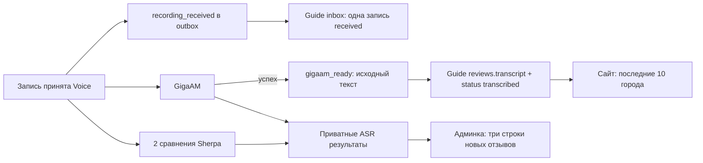

# Отзывы: город и компактная лента

Текущее решение владельца от 04.11.2026 заменяет прежние требования ручной
модерации, редакционного текста, привязок и оценки ASR в старых Voice/бета-ТЗ.
Сайт автоматически показывает **10 последних отзывов города, с состоянием ожидания до GigaAM**.
Варианты Sherpa доступны только администратору и никогда не заменяют
публичный текст исходного GigaAM.

## Интерфейс

В общей шапке админки — логотип и POST «Выйти» с CSRF. Строки «Рабочий стол.» и
слогана в админке нет. Публичная шапка сохраняется, страница входа без выхода.

`/guide/admin/reviews`: слева поиск и города с записями, свежая активность сверху;
справа лента выбранного города, новые записи сверху. Город задаётся путём
`/guide/admin/reviews/{slug}`, поиск и пагинация — `q` и `page`. По 20 записей
в админке; ограничение сайта в 10 не удаляет историю.

Карточка: номер, дата UTC, **плеер в этой же верхней строке**, ссылка «Лог»;
ниже три строки новых отзывов (GigaAM через onnx-asr и два Sherpa), затем
компактные метаданные. Исторические отзывы сохраняют прежние результаты. Тексты показываются
целиком с переносами. Незавершённая/ошибочная модель имеет собственное состояние.
На телефоне sidebar располагается над лентой с ограниченной высотой списка городов.

У каждого отзыва кнопка «Удалить»: только admin+CSRF, сразу убирает его из обеих лент.
Статус deleted сохраняется для защиты от поздних событий, аудит review_deleted и лог
остаются доступны; это не физическое стирание аудио. Повтор удаления безопасен.

Нет эталона, победителя, оценок качества, ручной правки текста/ресторана, решений,
форм повторного распознавания и анализа. Определение ресторана/сути — будущий этап.
`/admin/reviews/{slug}/{number}` открывает нужную страницу ленты и якорь карточки.
Отдельный публичный технический лог: `/guide/logs/reviews/{slug}/{number}`. Исходные ответы,
ревизии моделей, хеши, попытки и события доставки находятся там. Аудио и raw metadata
остаются доступны только администратору, ответы имеют `Cache-Control: private,no-store`.

## Поток и источники данных

Приём и receipt event коммитятся одной транзакцией. Результат GigaAM, завершение
этапа и primary event — другой атомарной транзакцией. Sherpa пишет только свой
ASR-кандидат. OpenAI-анализ и задания на ручной повтор не планируются.
Guide сначала сохраняет inbox и cursor, затем применяет событие. ACK только после
сохранения. Receipt и primary коммутируют: поздний receipt не стирает готовый текст.
Дубликат не создаёт второй отзыв. Epoch/reset fencing, leases, ограниченные повторы
прерванного локального inference и повтор разбора уже сохранённого raw response
сохраняются. Повтор доставки ошибочного inbox доступен в логе; это не новый inference.

GigaAM-only правило действует в единой общей ленте виджета; личного списка нет. Завершение Sherpa
не удерживает polling и не меняет состояние публикации. Админка получает результаты
страницы одним приватным batch-запросом `POST /internal/v1/admin/recognitions`;
три SQL-запроса на весь batch, максимум 30 references. GET страниц ничего не распознаёт.

## Переход БД и откат

1. Выпускать Guide и Voice одной проверенной версией ([runtime и общий переход](VOICE_RUNTIME.md)). Штатный deploy останавливает
   web, worker, объединённый voice и voice-worker перед миграциями. Не запускать
   миграцию поверх работающего старого исполнителя.
2. Приватный Guide dump создаётся существующим механизмом до миграции.
   После переноса Voice в общую БД для Voice <6 deploy создаёт проверенный dump её схемы
   `releases/{sha}/pre-voice-stream.{deployment_id}.dump`, до изменения Voice БД.
   Оба файла принадлежат текущей операции, не публикуются.
3. `alembic upgrade head`: `review_stream` после `filling_top3`. Расширяет CHECK
   состояний `received`/`transcribed`, добавляет индекс города/времени/номера.
   Не удаляет отзывы, каталог, ручные вступления, звёзды, историю или аудио.
4. `voice migrate`: версия 6 после 5. Удаляет **asr_evaluations** и
   **asr_evaluation_events** с эталонами/победителями/заметками. Отменяет ожидающие
   устаревшие анализы/оценочные прогоны, сохраняя их raw response/диагностику.
   Исторические ASR-кандидаты, submissions/runs, аудио, ручные данные Guide и
   старые outbox payload не удаляются и не обнуляются.
5. Версия 6 добавляет новые receipt events для имеющихся записей и primary events
   только из сохранённых **gigaam** candidates. Новые sequence идут после старого
   cursor/ACK. Исторический fallback Parakeet не становится GigaAM; прежние
   transcript_ready/analysis_ready events сохраняются в inbox как история,
   но больше не управляют публичным текстом. Платных запросов/inference нет.
6. Запустить новую версию Voice, consumer, web/worker, дождаться доставки.
   Старые отзывы становятся публичными по мере получения подтверждённого primary
   event. Запись без результата GigaAM остаётся только в админке.

Автоматический rollback неудачного cutover восстанавливает Voice dump вместе с
Guide dump при остановленных исполнителях, затем запускает прежний образ.
Для ручного отката после открытия сайта сохранить новые записи и следовать обычным
правилам восстановления согласованных БД: image-only откат на код до этого изменения
не восстанавливает удалённые оценки. Forward fix предпочтителен. Ручная quality-оценка
намеренно удалена; обычный downgrade Guide не восстанавливает её.

## Ручная приёмка

- `/guide/admin`, `/guide/admin/locations`, `/guide/admin/reviews`: компактная
  общая шапка, выход работает; после выхода нет кнопки выхода на форме входа.
- `/guide/admin/reviews/ivanovo`: только отзывы Иванова; переключить город,
  поиск, пустой поиск, страницу 2, затем прямую ссылку на старую карточку.
- При записи увидеть карточку до готовности ASR. После GigaAM увидеть её текст
  на `/guide/ivanovo`; ожидание/ошибка Sherpa не должны задержать текст.
- Проверить отдельные ошибки моделей: Sherpa-only результат виден в админке,
  отсутствует на сайте и в API/общей ленте.
- Добавить >10 успешных отзывов: сайт показывает 10 новых, админка сохраняет все.
- Проверить desktop 1440, tablet 768, mobile 390/360: плеер в верхней строке,
  три компактных текста, без горизонтальной прокрутки и редакторских форм.
- Открыть «Лог» без сессии: 200, без IP/UA/cookie/metadata/секретов; аудио: 401.
  в обычной ленте нет хешей, ревизий, WER/CER и raw JSON.
- На тестовой БД проверить повтор receipt/primary, потерю ACK, первичный результат
  раньше receipt, сброс эпохи во время обработки, миграцию старого Parakeet fallback.

Ссылки выше описывают маршруты после установки PR, не утверждают наличие изменений
на production. Реальные модели, платные API и production-миграции тесты не запускают.

## Проверки реализации

Локально: 400 тестов общего прогона (unit/integration/e2e/deployment), затем
14 целевых проверок границы Voice/Guide и старых frozen-заданий с Parakeet;
Ruff, форматирование, mypy, shellcheck и actionlint. Отдельный одноразовый
PostgreSQL: populated Voice 5 → 6 → `pg_restore --clean --single-transaction` 5,
с проверкой возврата schema version/исходных записей/исторической оценки и наличия
аудио. Миграция в тестах также повторяется и проверяет отсутствие Parakeet fallback.
Матрица реальных шаблонов: [desktop/mobile screenshots](design/admin-reviews/README.md).
Docker build и существующий Guide cutover/rollback smoke выполняются в PR CI.

## Сравнение трёх вариантов для новых отзывов

Согласованный макет и реальный локальный рендер:
[desktop](design/voice-sherpa-comparison/admin-1440.png),
[телефон](design/voice-sherpa-comparison/admin-390.png).
Скриншоты интерфейса используют тестовые тексты, а не результат измерения точности ASR.

Одна карточка и один плеер сохраняются. После прежней строки GigaAM
показаны два результата GigaAM/Sherpa: без словаря и со словарём.
Под каждым текстом — фактический словарь; при ожидании он уже доступен из frozen
request, при готовности читается из сохранённого результата. Длинный список
полностью переносится по ширине; раскрывающей кнопки, отдельного редактора словаря
и новой страницы нет. Старые отзывы сохраняют имеющиеся результаты, повторно не запускаются.

Переход Voice 7 → 8 расширяет ключ результата, не удаляя ни одной записи.
Полный выпуск/backup описан в [VOICE_RUNTIME.md](VOICE_RUNTIME.md).
