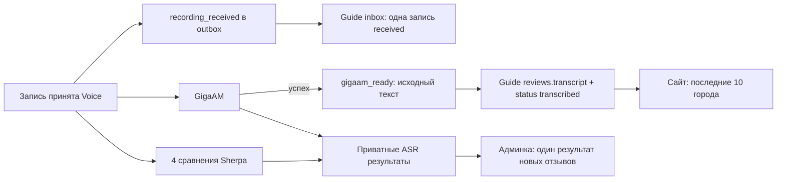

# Отзывы: город и компактная лента

Текущее решение владельца от 04.11.2026 заменяет прежние требования ручной
модерации, редакционного текста, привязок и оценки ASR в старых Voice/бета-ТЗ.
Сайт автоматически показывает **10 последних отзывов города, с состоянием ожидания до GigaAM**.
Варианты Sherpa доступны только администратору и никогда не заменяют
публичный текст основного профиля, зафиксированного при приёме записи.

## Интерфейс

В общей шапке админки — логотип и POST «Выйти» с CSRF. Строки «Рабочий стол.» и
слогана в админке нет. Публичная шапка сохраняется, страница входа без выхода.

`/guide/admin/reviews`: слева поиск и города с записями, свежая активность сверху;
справа лента выбранного города, новые записи сверху. Город задаётся путём
`/guide/admin/reviews/{slug}`, поиск и пагинация — `q` и `page`. По 20 записей
в админке; ограничение сайта в 10 не удаляет историю.

Карточка: номер, дата UTC, **плеер в этой же верхней строке**,
соседние действия «Перераспознать» и «Удалить»;
ниже один результат новых отзывов (Sherpa с родным токенизатором), затем
компактные метаданные. Исторические отзывы сохраняют прежние результаты. Тексты показываются
целиком с переносами. Незавершённая/ошибочная модель имеет собственное состояние.
На телефоне sidebar располагается над лентой с ограниченной высотой списка городов.

У каждого отзыва кнопка «Удалить»: только admin+CSRF, сразу убирает его из обеих лент.
Статус deleted сохраняется для защиты от поздних событий, аудит review_deleted и лог
остаются доступны; это не физическое стирание аудио. Повтор удаления безопасен.

Нет эталона, победителя, оценок качества, ручной правки текста/ресторана, решений,
форм анализа. Определение ресторана/сути — будущий этап.
`/admin/reviews/{slug}/{number}` открывает нужную страницу ленты и якорь карточки.
Отдельный публичный технический лог: `/guide/logs/reviews/{slug}/{number}`. Исходные ответы,
ревизии моделей, хеши, попытки и события доставки находятся там. Аудио и raw metadata
остаются доступны только администратору, ответы имеют `Cache-Control: private,no-store`.

## Поток и источники данных

Плеер — один HTML audio с компактными Play/Pause, перемоткой и временем.
Шкала показывает только `currentTime`, а не буфер загрузки. Состояние кнопки
следует событиям audio, движение шкалы — requestAnimationFrame с чтением того же
currentTime, без собственного таймера позиции. DOM кнопки/иконок не пересоздаётся.
При ошибке загрузки/запуска отображается сообщение. Без JS остаются нативные controls.

`hx-preserve` сохраняет весь плеер с постоянным id отзыва при обновлении карточки;
позиция/пауза не сбрасываются при очередном результате ASR. При удалении карточки
воспроизведение и animation frame останавливаются, обработчики очищаются.
На телефоне плеер — отдельной строкой, оба действия рядом под ним; на широком
экране всё в одной строке. Общие отступы форм не применяются к действиям карточки.
Браузерные снимки с синтетическими аудио/текстом: `docs/design/admin-review-player/`.

Приём и receipt event коммитятся одной транзакцией. Результат GigaAM, завершение
этапа и primary event — другой атомарной транзакцией. Sherpa пишет только свой
ASR-кандидат. OpenAI-анализ и задания на ручной повтор не планируются.
Guide сначала сохраняет inbox и cursor, затем применяет событие. ACK только после
сохранения. Receipt и primary коммутируют: поздний receipt не стирает готовый текст.
Дубликат не создаёт второй отзыв. Epoch/reset fencing, leases, ограниченные повторы
прерванного локального inference и повтор разбора уже сохранённого raw response
сохраняются. Повтор доставки ошибочного inbox доступен в логе; это не новый inference.

GigaAM-only правило действует в единой общей ленте виджета; личного списка нет. Завершение Sherpa
не удерживает polling и не меняет состояние публикации. Админка получает результаты
страницы одним приватным batch-запросом `POST /internal/v1/admin/recognitions`;
три SQL-запроса на весь batch, максимум 30 references. GET страниц ничего не распознаёт.

## Переход БД и откат

1. Выпускать Guide и Voice одной проверенной версией ([runtime и общий переход](VOICE_RUNTIME.md)). Штатный deploy останавливает
   web, worker, объединённый voice и voice-worker перед миграциями. Не запускать
   миграцию поверх работающего старого исполнителя.
2. Приватный Guide dump создаётся существующим механизмом до миграции.
   После переноса Voice в общую БД для Voice <6 deploy создаёт проверенный dump её схемы
   `releases/{sha}/pre-voice-stream.{deployment_id}.dump`, до изменения Voice БД.
   Оба файла принадлежат текущей операции, не публикуются.
3. `alembic upgrade head`: `review_stream` после `filling_top3`. Расширяет CHECK
   состояний `received`/`transcribed`, добавляет индекс города/времени/номера.
   Не удаляет отзывы, каталог, ручные вступления, звёзды, историю или аудио.
4. `voice migrate`: версия 6 после 5. Удаляет **asr_evaluations** и
   **asr_evaluation_events** с эталонами/победителями/заметками. Отменяет ожидающие
   устаревшие анализы/оценочные прогоны, сохраняя их raw response/диагностику.
   Исторические ASR-кандидаты, submissions/runs, аудио, ручные данные Guide и
   старые outbox payload не удаляются и не обнуляются.
5. Версия 6 добавляет новые receipt events для имеющихся записей и primary events
   только из сохранённых **gigaam** candidates. Новые sequence идут после старого
   cursor/ACK. Исторический fallback Parakeet не становится GigaAM; прежние
   transcript_ready/analysis_ready events сохраняются в inbox как история,
   но больше не управляют публичным текстом. Платных запросов/inference нет.
6. Запустить новую версию Voice, consumer, web/worker, дождаться доставки.
   Старые отзывы становятся публичными по мере получения подтверждённого primary
   event. Запись без результата GigaAM остаётся только в админке.

Автоматический rollback неудачного cutover восстанавливает Voice dump вместе с
Guide dump при остановленных исполнителях, затем запускает прежний образ.
Для ручного отката после открытия сайта сохранить новые записи и следовать обычным
правилам восстановления согласованных БД: image-only откат на код до этого изменения
не восстанавливает удалённые оценки. Forward fix предпочтителен. Ручная quality-оценка
намеренно удалена; обычный downgrade Guide не восстанавливает её.

## Ручная приёмка

- `/guide/admin`, `/guide/admin/locations`, `/guide/admin/reviews`: компактная
  общая шапка, выход работает; после выхода нет кнопки выхода на форме входа.
- `/guide/admin/reviews/ivanovo`: только отзывы Иванова; переключить город,
  поиск, пустой поиск, страницу 2, затем прямую ссылку на старую карточку.
- При записи увидеть карточку до готовности ASR. После GigaAM увидеть её текст
  на `/guide/ivanovo`; ожидание/ошибка Sherpa не должны задержать текст.
- Проверить отдельные ошибки моделей: Sherpa-only результат виден в админке,
  отсутствует на сайте и в API/общей ленте.
- Добавить >10 успешных отзывов: сайт показывает 10 новых, админка сохраняет все.
- Проверить desktop 1440, tablet 768, mobile 390/360: плеер в верхней строке,
  один компактный результат, без горизонтальной прокрутки и редакторских форм.
- Открыть «Лог» без сессии: 200, без IP/UA/cookie/metadata/секретов; аудио: 401.
  в обычной ленте нет хешей, ревизий, WER/CER и raw JSON.
- На тестовой БД проверить повтор receipt/primary, потерю ACK, первичный результат
  раньше receipt, сброс эпохи во время обработки, миграцию старого Parakeet fallback.

Ссылки выше описывают маршруты после установки PR, не утверждают наличие изменений
на production. Реальные модели, платные API и production-миграции тесты не запускают.

## Проверки реализации

Локально: 400 тестов общего прогона (unit/integration/e2e/deployment), затем
14 целевых проверок границы Voice/Guide и старых frozen-заданий с Parakeet;
Ruff, форматирование, mypy, shellcheck и actionlint. Отдельный одноразовый
PostgreSQL: populated Voice 5 → 6 → `pg_restore --clean --single-transaction` 5,
с проверкой возврата schema version/исходных записей/исторической оценки и наличия
аудио. Миграция в тестах также повторяется и проверяет отсутствие Parakeet fallback.
Матрица реальных шаблонов: [desktop/mobile screenshots](design/admin-reviews/README.md).
Docker build и существующий Guide cutover/rollback smoke выполняются в PR CI.

## Один профиль с родным токенизатором

Один плеер и один результат новых отзывов. Основной5.5/8 помечен «Публикуется на сайте»;
в его строке «До» — ответ модели, «После» — сохранённый публикуемый текст с
восстановленным каталоговым регистром. Точные настройки и фактические подсказки
показаны под каждым результатом, включая строчные варианты названий.
Падежные формы сохраняются: «в иванове» → «в Иванове», «в плёсе» → «в Плёсе».
Сырые ответы моделей не переписываются; исторические варианты остаются доступны.
Исторические отзывы не получают новые проходы и не переписываются.
Скриншоты реального шаблона с тестовыми текстами:
[desktop](design/voice-sherpa-comparison/admin-1440.png),
[телефон](design/voice-sherpa-comparison/admin-390.png).
Порядок подготовки и публикации: [VOICE_SHERPA_COMPARISON.md](VOICE_SHERPA_COMPARISON.md).

## Плеер и агентская диагностика

В админке убраны ссылки на логи, включая общую навигацию. Диагностика остаётся
по документированным адресам и JSON-индексу для агента. Нативный audio использует
controlslist=nodownload/noplaybackrate/noremoteplayback, без меню. Для WebM
playback=true отдаёт временно remux-ированный контейнер с конечной длительностью
и поддержкой Range/If-Range, без перекодирования и изменений оригинала.
Оригинал выдаётся без playback=true, с исходным SHA256. Исследование ASR использует
только оригиналы, а не проигрываемое представление. [VOICE_CORPUS.md](VOICE_CORPUS.md).

## Категории и публичные ленты

До классификации новые отзывы видны только автору на странице города и в виджете.
Успешная актуальная категория ok/humor разрешает публичный показ без нажатия «ОК»;
bugs скрыт от всех, other — от остальных посетителей и в публичных лентах/MCP.
Повторное ASR с новым текстом делает автоматическую классификацию устаревшей,
возвращает отзыв в «Новые» и закрывает его от остальных до нового анализа.
В новых отзывах кнопки расположены «ОК», «Баг», «Удалить».
POST /admin/reviews-2/{slug}/{number}/bug требует входа и CSRF, записывает
review_analyses.manual_category=bugs и событие review_marked_bug с автором действия.
Ответ ИИ, аудио, расшифровка и история не переписываются. Ручной баг остаётся
скрытым при повторном ASR и позднем ответе ИИ. Повтор кнопки идемпотентен.
Отдельного сохраняемого флага публичности категории нет: общий SQL-предикат
сочетает пригодность ASR, актуальный результат ИИ и ручную категорию.

### Юмор
Категория humor автоматически открывается во вкладке /admin/reviews-2/humor
без подтверждения и появляется в публичных лентах вместе с категорией ok.
Рестораны и голоса не создаются. Содержательная оценка ресторана с шуткой — ok,
добрая история вокруг еды без оценки заведения — humor. Реклама и оскорбления
не становятся юмором. Старые результаты автоматически не переклассифицируются.

### Ручной перенос в юмор
В «Новых» и «ОК» есть кнопка «Юмор». Она сохраняет manual_category=humor
независимо от ответа ИИ, сразу переносит карточку во вкладку «Юмор» и оставляет
отзыв публичным. Исходный и ранее одобренный текст сохраняются.
При переносе одобренного отзыва его голоса удаляются с пересчётом рейтинга;
сами рестораны сохраняются. Повторный клик не снимает голоса повторно.
В аудит review_marked_humor записываются администратор, прежний результат,
ручная категория и снятые голоса. Поздний результат ИИ и перераспознавание
не отменяют решение, новые задания анализа для ручной категории не создаются.

### Свои отзывы до классификации и «Разное»
До успешной актуальной ИИ-классификации отзыв виден только автору на странице
города и в API виджета. Публичная выдача открывается после `ok`/`humor`, без
ожидания кнопки «ОК». Ошибочный или устаревший анализ публикацию не разрешает.
На странице локации и в API виджета категория other видна автору по совпадению
cookie guide_visitor с reviews.visitor. Чужие other скрыты. Это та же лента
последних десяти отзывов, с общим порядком по времени, без отдельного списка.
HTML и обновление виджета используют одно условие, включая publication_statuses.
Баги, ручные баги и удалённые отзывы скрыты даже для автора. Главная и MCP
остаются полностью публичными: персональное исключение туда не передаётся.
Cookie не выводится в ответ. При её утрате автор перестаёт видеть свои other.
Персональные ответы не кешируются. Категория и голоса в БД не меняются.
