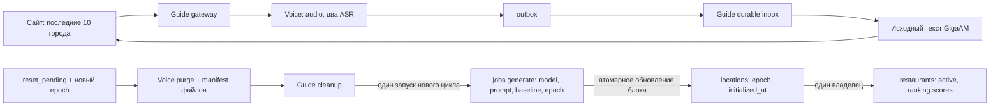

# Текущая архитектура беты

Нормативный документ: [BETA_CORE_SIMPLIFICATION_SPEC.md](BETA_CORE_SIMPLIFICATION_SPEC.md).
Он заменяет противоречащие ему положения старых MVP/Voice/маршрутных ТЗ.
Наполнение разделено на независимые операции: [INCREMENTAL_CONTENT.md](INCREMENTAL_CONTENT.md).
Позднейшее решение по отзывам имеет приоритет: [ADMIN_REVIEWS.md](ADMIN_REVIEWS.md).

У ресторана один владелец `restaurants.location_id`. В записи хранятся активность
и исходные оценки восьми критериев. Балл и порядок вычисляются по единому правилу
для сайта и админки; `position` и сохранённого `totalScore` нет
([контракт рейтинга](RESTAURANT_RANKING.md)). Обычная страница собирается из локации и её
активных ресторанов. `locations.page_data`, вторичные подборки и attach удалены.
Надлокация `is_hub=true` содержит навигацию по детям, без ресторанов, наполнения и
голосового виджета. Наличие детей само по себе не превращает город в надлокацию.

У страницы одна актуальная версия. `revision` — защита от конкурентной записи,
не история. Применённый дифф принадлежит источнику: заданию наполнения, отзыву или
ручной правке вступления. Вступление сохраняется отдельной кнопкой. No-op ручного сохранения не меняет
revision и не создаёт дифф. Дизайн админки из PR17 и распознавание обеими моделями сохранено; отзывы показываются компактной лентой городов.

Первоначальное наполнение фиксирует `jobs.model/prompt/content_epoch/baseline_revision`.
Состояние запроса и исходный ответ находятся в `generation_requests`, результат
проверки — в `jobs.report`, применение — в `jobs.applied` и `locations.initialized_at`.
Audit — диагностика; его удаление не меняет модель, доступность операции или результат.
Успешное применение атомарно с записью изменяемого блока каталога. Новые запросы
после успеха доступны независимо для вступления, поиска и ресторана; один готовый
ответ повторно не применяется. Удаление последнего ресторана не открывает публичный запуск.

Посетитель может заказать только первую попытку пустого цикла. После ошибки повтор
заказывает администратор из конкретного лога. Получение того же ответа использует
сохранённый response ID и GET/polling; неизвестный исход POST не означает новую покупку.
Один активный запуск на город, PostgreSQL-очередь, leases и технические лимиты сохранены; денежный учёт отключён.

Все роли записывают обычный отзыв через один gateway и отдельный Voice backend.
Voice API и доставка работают в контейнере `voice`; обе схемы данных находятся
в одной PostgreSQL БД. [Устройство и переход](VOICE_RUNTIME.md).
Guide хранит каталог и публичные исходные тексты GigaAM. Voice хранит
оригинальное аудио, оба ASR-результата и доставку. Сайт показывает 10 последних
готовых текстов автоматически, Parakeet виден только в админке. Ручных решений,
правок текста/ресторана и оценок распознавания нет; анализ сути — будущий этап. Редакторский голос, AlexCommands,
Guide-transcription bridge, архивные адаптеры и jobs review удалены. Звезда ресторана
сохраняется как атрибут, голос её не меняет. Жесты из отложенного ТЗ не реализуются.

IP, полный User-Agent и точное значение `guide_visitor` берутся сервером и хранятся
как raw-метаданные. Клиент не назначает себе роль, владельца или IP. Эти поля
доступны администратору, не публичной странице/публичным логам. Хеши аудио,
паролей, сессий и ключи идемпотентности остаются техническими средствами.

Consumer сначала сохраняет payload в durable inbox и двигает cursor в той же
транзакции. Ошибка применения остаётся в inbox с ручным повтором; независимые
отзывы продолжают доставляться. Receipt и primary result одного reference применяются в любом порядке.
ACK отправляется после durable commit. Ошибка самой записи inbox прерывает пакет.

Полный сброс повышает `content_epoch`, закрывает локацию и создаёт одну задачу reset.
Voice удаляет данные/файлы с durable manifest и подтверждает purge новой эпохи;
Guide подтверждает свои файлы и удаляет зависимости. Только затем одна транзакция
открывает новый цикл и ставит один первоначальный запуск. Ошибки возобновляются с
тем же ключом. Старые callbacks/события/диагностика не создают данные заново.
Идентификаторы ресторанов/отзывов и счётчик логов не переиспользуются.

[Переход и эксплуатация](BETA_CORE_RUNBOOK.md) · [маршруты](ADMIN_ROUTES.md) ·
[Voice API](VOICE_API.md) · [временные механизмы](LEGACY_REMOVAL.md).

Схема после перехода:

До перехода те же карточки дублировались в page_data и вторичных links, а запись
администратора могла уйти в отдельный командный pipeline. Эти источники и пути
удалены, а не оставлены режимами совместимости.

Наполнение использует три промпта: вступление, поиск мест и исследование одного
ресторана. Карточка и оценка обновляются раздельно, каталог накапливается;
закрытый API принимает подготовленные ответы без вызова модели: [FILLING.md](FILLING.md).
