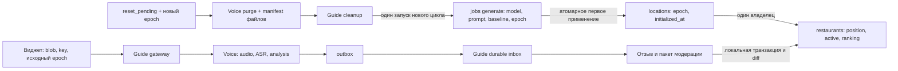

# Текущая архитектура беты

Нормативный документ: [BETA_CORE_SIMPLIFICATION_SPEC.md](BETA_CORE_SIMPLIFICATION_SPEC.md).
Он заменяет противоречащие ему положения старых MVP/Voice/маршрутных ТЗ.

У ресторана один владелец `restaurants.location_id`. Порядок, активность и рейтинг
хранятся в самой записи ресторана. Обычная страница собирается из локации и её
активных ресторанов. `locations.page_data`, вторичные подборки и attach удалены.
Надлокация `is_hub=true` содержит навигацию по детям, без ресторанов, наполнения и
голосового виджета. Наличие детей само по себе не превращает город в надлокацию.

У страницы одна актуальная версия. `revision` — защита от конкурентной записи,
не история. Применённый дифф принадлежит источнику: заданию наполнения, отзыву или
ручной правке вступления. Вступление сохраняется отдельной кнопкой. No-op не меняет
revision и не создаёт дифф. Дизайн админки из PR17 и карточки отзывов из PR18 сохранены.

Первоначальное наполнение фиксирует `jobs.model/prompt/content_epoch/baseline_revision`.
Состояние запроса и исходный ответ находятся в `generation_requests`, результат
проверки — в `jobs.report`, применение — в `jobs.applied` и `locations.initialized_at`.
Audit — диагностика; его удаление не меняет модель, доступность операции или результат.
Успешное применение атомарно с записью каталога. После успеха regenerate/reprocess
закрыты на сервере. Удаление последнего ресторана не открывает публичный запуск.

Посетитель может заказать только первую попытку пустого цикла. После ошибки повтор
заказывает администратор из конкретного лога. Получение того же ответа использует
сохранённый response ID и GET/polling; неизвестный исход POST не означает новую покупку.
Один активный запуск на город, PostgreSQL-очередь, leases, бюджет и лимиты сохранены.

Все роли записывают обычный отзыв через один gateway и отдельный Voice backend.
Guide хранит каталог, текст отзыва, модерацию и применение пакета. Voice хранит
оригинальное аудио, ASR/анализ и доставку. Редакторский голос, AlexCommands,
Guide-transcription bridge, архивные адаптеры и jobs review удалены. Звезда ресторана
сохраняется как атрибут, голос её не меняет. Жесты из отложенного ТЗ не реализуются.

IP, полный User-Agent и точное значение `guide_visitor` берутся сервером и хранятся
как raw-метаданные. Клиент не назначает себе роль, владельца или IP. Эти поля
доступны администратору, не публичной странице/публичным логам. Хеши аудио,
паролей, сессий и ключи идемпотентности остаются техническими средствами.

Consumer сначала сохраняет payload в durable inbox и двигает cursor в той же
транзакции. Ошибка применения остаётся в inbox с ручным повтором; независимые
отзывы продолжают доставляться. Зависимые события одного reference ждут предыдущие.
ACK отправляется после durable commit. Ошибка самой записи inbox прерывает пакет.

Полный сброс повышает `content_epoch`, закрывает локацию и создаёт одну задачу reset.
Voice удаляет данные/файлы с durable manifest и подтверждает purge новой эпохи;
Guide подтверждает свои файлы и удаляет зависимости. Только затем одна транзакция
открывает новый цикл и ставит один первоначальный запуск. Ошибки возобновляются с
тем же ключом. Старые callbacks/события/диагностика не создают данные заново.
Идентификаторы ресторанов/отзывов и счётчик логов не переиспользуются.

[Переход и эксплуатация](BETA_CORE_RUNBOOK.md) · [маршруты](ADMIN_ROUTES.md) ·
[Voice API](VOICE_API.md) · [временные механизмы](LEGACY_REMOVAL.md).

Схема после перехода:

До перехода те же карточки дублировались в page_data и вторичных links, а запись
администратора могла уйти в отдельный командный pipeline. Эти источники и пути
удалены, а не оставлены режимами совместимости.
