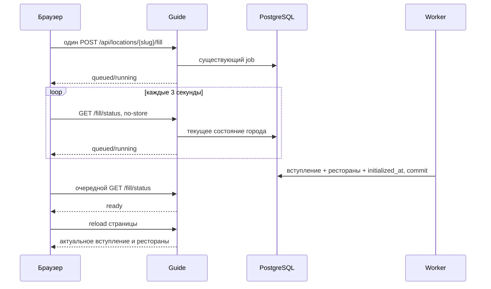

# Ожидание первичного наполнения города

Утверждено владельцем 7 ноября 2026: спиннер №2 из двенадцати точек,
анимированное вступление и семь сообщений одним шрифтом.
[Офлайн-макет](design/public-fill-loading/approved.html).
Скриншоты реализации на локальном приложении с тестовыми данными:
[телефон](design/public-fill-loading/implemented/waiting-390.png),
[широкий экран](design/public-fill-loading/implemented/waiting-1280.png),
[результат](design/public-fill-loading/implemented/ready-390.png).

## Что происходит

Кнопка полностью исчезает после нажатия. Вместо «Здесь скоро появится…» —
мерцающие частицы в форме строк. Заголовок «Подборка в работе» удалён с экрана
наполнения. По центру — спиннер и одна фраза Arial 23/21 px, без дополнительных
подписей. Каждые 5 секунд фраза плавно меняется:

1. Запускаем гастрономическую разведку.
2. Сканируем город и его окрестности.
3. Собираем сигналы: меню, отзывы, репутацию.
4. Фильтруем шум. Выделяем сильные места.
5. Сопоставляем кухню, сервис и атмосферу.
6. Сводим лучшие находки в короткий список.
7. Собираем вашу подборку из проверенных мест.

Дальше цикл повторяется. Это стилизованное описание всей операции, не события
worker. Фразы не управляют готовностью: результат появляется сразу, без ожидания
конца фразы или цикла. Нет процентов, отсчёта и обещания завершения за 30 секунд.

## От БД к экрану



Сервер выдаёт `ready` по сохранённому `locations.initialized_at`; рестораны,
вступление и признак наполнения применяются в прежней транзакции. От commit до
обнаружения — очередной опрос (3 секунды) плюс время HTTP/рендера. Цикл фраз
ничего не задерживает. API, worker, БД и процесс исследования не изменены;
миграций/новых зависимостей/дополнительных AI-вызовов нет.

Переоткрытая queued/running-страница сразу показывает ожидание. Если commit
случился между чтением содержимого страницы и статуса, клиент перечитывает
страницу с `ready`. Возврат из BFCache восстанавливает опрос.

Потерянный ответ на POST выясняется через GET; POST не повторяется. При обрыве
сети, 408/429/5xx и повреждённом JSON чтение продолжается. Один запрос ограничен
10 секундами. Прочие HTTP 4xx прекращают ожидание с просьбой обновить страницу.
Настоящий `failed` останавливает анимацию и показывает сообщение сервера;
повтор не предлагается при `can_start=false`. Готовые страницы не загружают
новые CSS/JS и не содержат формы/canvas.

Без JS сохраняется форма POST/303 и ссылка обновления страницы. Reduced motion
делает точки/частицы статичными; смена текста идёт без движения. Скрытая вкладка
останавливает canvas и фразы, чтение статуса остаётся. Экранный диктор получает
стабильный статус, без объявления каждой фразы. Voice не изменён.

## Проверка

`tests/e2e/test_public_fill_loading.py`: реальное приложение по HTTP, отдельная
PostgreSQL-схема, обычный worker и FakeAI. Проверяются 320/390/1280 px, автоматическое
появление вступления/ресторана, повторное открытие pending, потерянный POST-ответ,
503/429/некорректный JSON статуса, ошибка провайдера, reduced motion и гонка
чтения/публикации. Реальных AI-запросов нет.

```sh
TEMPORARY_PUBLIC_FILL_ENABLED=true FILL_SCREENSHOTS_DIR=var/public-fill-screenshots pytest -q tests/e2e/test_public_fill_loading.py
```

Нужны PostgreSQL (`TEST_DATABASE_URL`) и установленный Chromium/Playwright.
Фикстуры создают/удаляют изолированные схемы. Для безопасного просмотра всех
состояний достаточно открыть офлайн-макет без сервера.

После будущего деплоя: открыть незаполненный город, нажать кнопку один раз,
дождаться вступления/карточек; перезагрузка во время работы должна сразу вернуть
ожидание. Клик на production запускает реальное исследование. Для визуального
просмотра использовать макет/скриншоты, не сбрасывать заполненные города.

Референсы: [Telegram Spoilers](https://telegram.org/blog/reactions-spoilers-translations),
[Material Progress](https://m1.material.io/components/progress-activity.html),
[NN/g о длительном ожидании](https://www.nngroup.com/articles/designing-for-waits-and-interruptions/).
