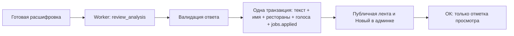

# Отзывы 2: автоматическое применение и очередь просмотра

`/guide/admin/reviews-2` открывает «Новые». Фильтры `/new`, `/ok`, `/humor`,
`/bugs`, `/other`; `page` — пагинация. Все города в одной ленте, новые сверху.
Исходник и результат ИИ видны сразу; ручного редактирования и запуска ИИ нет.

## Принятое поведение

Успешный анализ применяется автоматически: имя, обработанный текст, связи с
ресторанами и голоса. «ОК» только отмечает просмотренным и переносит отзыв из
«Новых» в «ОК». Оно не публикует, не создаёт ресторан и не начисляет повторный голос.
До отметки просмотра результат уже доступен на сайте. Новые ошибки остаются
в очереди с диагностикой; неприменённый или устаревший результат отметить нельзя.

Промпт — `data/prompts/review-analysis-v1.txt`, модель — сохранённая настройка
задания. Ответ содержит category, author_name, edited_text, mentions и reason.
Цитата обязана присутствовать в исходнике, ID — в переданном каталоге; неизвестный
предложенный ресторан требует положительного голоса. Именная нормализация
использует исходное название и каталог, сохраняя падеж. Исходник не переписывается.
Внешние запросы выполняются вне транзакций. GET-страницы не запускают обработку.

## Данные и атомарность

Новых полей, таблиц и миграций для этого изменения нет:

- `reviews.transcript` — исходная расшифровка; `author_name` и `edited_text` —
  автоматически применённые значения. Публичные читатели используют редакцию
  после применения. Пустой результат скрывается, исходник/анализ сохраняются.
- `review_analyses` — текущий результат и его исходный текст. Исторические поля
  `approved_at`/`approved_by` теперь обозначают просмотр администратором, а не
  разрешение публикации. Смена исходника сбрасывает эту отметку.
- `jobs.applied` — факт применения результата. Используется для идемпотентности
  и чтения ресторанного заголовка. `job.status=done` сам по себе недостаточен.
- `review_restaurant_votes` — уникальная пара отзыв/ресторан с ±1. Сумма в
  `restaurants.review_score` поддерживается существующим триггером. Восьмифакторный
  рейтинг и публичный топ автоматически не пересчитываются.
- Предложенный неизвестный ресторан автоматически создаётся в той же `restaurants`:
  name/location_id, active=0, прочие неизвестные факты NULL. Точное название в одном
  городе переиспользует запись. Неопределённое/нейтральное неизвестное упоминание
  не создаёт карточку; известный ресторан без оценки не получает голос.

Обработка держит блокировки локация → отзыв → анализ/задание, проверяет lease,
актуальность исходника, эпоху и удаление. Применение результатов и done атомарны.
Повторное применение, параллельный «ОК» и его повтор не увеличивают счёт второй раз.
Удаление снимает голоса один раз. Смена расшифровки снимает прежний результат и
запускает новый анализ; после успеха он применяется автоматически, без ожидания «ОК».
Поздний ответ не возвращает удалённый отзыв или сброшенную локацию.

## Категории и ручные действия

У категории ok ресторанные связи/голоса применяются автоматически. Humor остаётся
публичным без ресторанных голосов. Bugs скрывается публично, other виден только
автору на странице своего города; главная/MCP его не показывают. Эти правила прежние.

«Баг» у нового отзыва и «Юмор» у нового/просмотренного задают ручную категорию с
приоритетом над поздним ИИ. Прежние голоса удаляются один раз. Обработчик сохранённых
ответов не восстанавливает их. Кнопка «Удалить» сохраняет историю и исключает отзыв
из публичной ленты. Технические действия фиксируются в audit.

## Переход после развёртывания

Перед постановкой очередных заданий worker применяет до 20 ранее сохранённых
успешных результатов за проход. Новый запрос к ИИ не нужен. Уже применённые
результаты пропускаются; прежние «ОК» сохраняются, новые применения остаются в
«Новых» до просмотра. Удалённые, устаревшие, вручную классифицированные и отзывы
старой эпохи пропускаются. Ошибка отдельного сохранённого результата откатывает
только его применение, записывается в audit/job.error и не блокирует остальные.

Поэтому Выборг №70 с сохранённым Paparazzi bistro получит ресторанный заголовок
без ручного «ОК», если к моменту развёртывания анализ всё ещё актуален. Никаких
изменений production этим PR до его развёртывания не выполняется.

## Диагностика и проверка

`/guide/logs/reviews-2.json` — индекс; `/guide/logs/reviews-2/{slug}/{number}` —
промпт, вход/ответ, ошибки и действия. Новые события: `review_analysis_applied`,
`review_analysis_acknowledged`, `review_auto_apply_failed`; старый журнал подтверждений
сохраняется. Нет IP/UA/ключей в экспорте; доступ определяется PUBLIC_FILL_LOGS_ENABLED.

Локальные PostgreSQL-тесты с mock OpenAI проверяют применение до «ОК», отсутствие
публичных изменений после «ОК», сохранённые ответы без AI, конкуренцию, удаление,
повторное распознавание, ручные категории, актуальность исходника и CSRF.
Браузер проверяет реальные шаблоны/HTMX и главную на широком и мобильном экранах.

Ручная проверка: `/guide/admin/reviews-2/new` → новый успешно обработанный отзыв:
его ресторан/имя/текст уже видны на `/guide/`. Нажать «ОК»: отзыв уходит из новых,
появляется в `/guide/admin/reviews-2/ok`, публичный текст/голоса остаются прежними.
Проверить текущий пример на `/guide/` и лог `/guide/logs/reviews-2/vyborg/70`.
