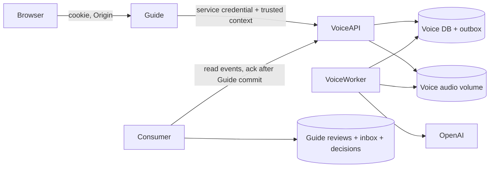

# Voice local operation, checks and rollback

This branch implements `VOICE_SERVICE_SPEC.md@90c396f`. Public routing defaults
off. Do not run a production deployment as part of this change.

## Processes and databases



Voice imports no Guide runtime and has no Guide database URL/credentials. The
Compose file provisions its own PostgreSQL cluster; the `voice` role exists only
there. For a shared server an administrator must provision a separate database
and login role, revoke public cross-database access, and grant only the Voice
database to that role. Never reuse Guide's role. Do not expose Voice's internal
port through the public site's nginx; the Guide gateway is the public boundary.

## Local setup

Requirements: Python 3.13, uv, PostgreSQL 17, ffprobe. Docker is optional.

```bash
uv sync --frozen
cp .env.voice.example .env.voice
```

Replace the placeholder password and service secret. For Compose,
`VOICE_DATABASE_URL` uses `voice-db`; its password must match
`VOICE_POSTGRES_PASSWORD`. Run the stack with the env file used for interpolation:

```bash
docker compose --env-file .env.voice -f compose.voice.yaml up --build -d
docker compose --env-file .env.voice -f compose.voice.yaml ps
curl --fail http://127.0.0.1:3100/health/ready
```

For local fake processing set `VOICE_FAKE_PROVIDER=true` in `.env.voice` before
starting. This mode explicitly returns test text and makes no OpenAI requests.
For real processing set it to false and provide `VOICE_OPENAI_API_KEY`.
Host-run processes instead use a separately provisioned PostgreSQL DB URL:

```bash
uv run voice migrate
uv run uvicorn involta_voice.main:create_app --factory --host 127.0.0.1 --port 3100 --no-access-log
# Another terminal:
uv run voice-worker
```

Guide's `.env.local` keeps its existing DATABASE_URL. Add the same
VOICE_SERVICE_SECRET, `VOICE_URL=http://127.0.0.1:3100`, and leave
`VOICE_ENABLED=false` until the consumer is ready. Apply the additive Guide
migration and start existing processes plus the consumer:

```bash
uv run alembic upgrade head
uv run guide seed
uv run uvicorn involta_guide.main:create_app --factory --host 127.0.0.1 --port 3000 --no-access-log
# Separate terminals, with the same Guide environment:
uv run guide-worker
uv run guide-voice-consumer
```

Set `VOICE_ENABLED=true` and restart Guide web to route the new visitor widget
to Voice. In containers, set VOICE_URL to Voice's private service address and
connect only the relevant application containers to a shared private network.
The consumer always uses Guide credentials, never Voice database credentials.

The existing Alex link is now an admin-cookie shortcut. The administrator cookie
marks trusted submissions via server-side session metadata; browser role fields
cannot grant it. Previously issued `guide_alex` sessions remain accepted during
transition. Trusted commands continue with Guide's existing executor, separate
prompt, permission/revision checks and immediate application rules.

## Review operation

Open `/guide/admin/voice` after administrator login. The queue includes existing
Guide history and imported Voice reviews; accepted Voice audio waiting for a
transcript is visible while the service is reachable. Original transcript and
editable text are separate. Rejection/fraud never delete either text or audio.
Publishing the text is a separate action from accepting it. Proposal acceptance
creates a draft; publishing the page remains a separate Guide action.

Use `/guide/admin/voice/{slug}/{number}` and its `/runs/{run}` link. Numbers and
run identities are persisted. Renamed slugs redirect to the current canonical
slug. Existing `/guide/logs/...` identities are untouched.

Changing the prompt/model affects new runs only. A new run reuses the original
successful transcript. Selecting a run for checking is explicit and does not
undo accepted decisions. Revalidation parses the saved raw answer without an
OpenAI call. An `unknown` paid attempt needs operator investigation; the worker
does not blindly repeat its POST. A new deliberate run is a new paid operation.

## Budgets, logs and storage

Intake is bounded by measured MIME/duration/size, visitor/IP windows, queue depth
and free disk. Paid calls have a daily count cap and a serialized budget
reservation. Unknown prices keep their reservation; they are not reported as
zero cost. `VOICE_PER_CALL_RESERVE_USD` is a conservative accounting reservation,
not an asserted provider tariff or a guaranteed external billing ceiling; set
an account-side OpenAI spending limit as well. Configure current per-million
input/output prices through the authorized settings API when known; requests
snapshot those prices and logs retain actual usage when returned.

Original audio in Voice has no automatic expiry. `voice orphan-audio` is dry-run
by default; `--execute` removes only files older than 24 hours proven unreferenced
while holding the intake lock. It never removes accepted submissions, including
rejected reviews. Legacy audio remains in Guide and the old explicit retention
command never processes Voice references.

Back up the Voice DB and audio volume together and the Guide DB/legacy audio
together. Quiesce intake/workers for a coordinated filesystem snapshot or use
your existing consistent backup procedure. Verify SHA/counts on restore before
resuming. Retain inbox/outbox and cursor; do not reset sequence identities while
keeping a consumer cursor from another backup.

## Rollback

1. Disable `VOICE_ENABLED` and restart Guide web. This only routes new uploads
   back to the compatible widget; do not stop Voice worker/consumer for already
   accepted submissions.
2. Keep the service URL/secret configured so new imported history/audio remains
   readable. Additive tables/fields remain; do not downgrade/drop migrations.
3. Old queued/running Guide reviews stay with guide-worker; Voice submissions
   have no Guide review job, so two executors cannot process one submission.
4. Keep a gateway-compatible image available: rolling back to an image from
   before this feature cannot render Voice audio references. Keep the new web
   gateway/read routes running or use the disabled-flag version of this image.

Production image references must be immutable digests. No changes to public
nginx, SSH, TLS, firewall or city-generation deployment are needed.

## Automated checks

Tests use fake providers/MockTransport, never paid OpenAI calls. Provision a
dedicated disposable PostgreSQL test instance. Its test role needs CREATEDB and
CREATEROLE because Voice tests create a separate database/role per fixture.
Do not point TEST_DATABASE_URL at production.

```bash
uv run ruff check src tests migrations deploy
uv run ruff format --check src tests migrations deploy
uv run mypy
uv run pytest -q tests/unit tests/integration tests/e2e tests/deployment
uv run voice openapi > work/voice-openapi.json
```

See `VOICE_API.md` for schemas, error semantics, event delivery and the editor
boundary. See `VOICE_IMPLEMENTATION.md` for checked stages and remaining limits.

## Legacy archive dry-run and copy

With the Guide environment loaded and Voice reachable, use:

```bash
uv run python -m involta_guide.infrastructure.voice.archive --limit 1000
# Inspect checked/skipped/missing_audio/sha_mismatch; resolve mismatches first.
uv run python -m involta_guide.infrastructure.voice.archive --limit 1000 --execute
# Repeat is safe: source_review and SHA map to the same read-only archive.
uv run python -m involta_guide.infrastructure.voice.archive --limit 1000 --execute
```

The limit is a deterministic prefix of history, not an offset; choose it large
enough to cover the intended history and compare totals. Active/trusted/deleted
records are skipped. Old IDs, ownership, jobs and Guide files remain unchanged.
Archive entries never enter the processing queue or Guide outbox.

## Compatibility with the current-page editor

Main now saves city edits directly to its single current page. Voice does not
change that behavior. Its reviewed proposal candidates live in
`voice_page_drafts`, pointing at retained unpublished version snapshots, and do
not modify restaurant rows or Guide's current version. Explicit publication
checks both the candidate and its base current revision, then uses Guide's
current save rules. A conflicting city edit returns 409. Discard the prepared
Voice candidate and compare again; snapshots and the decision journal remain.
