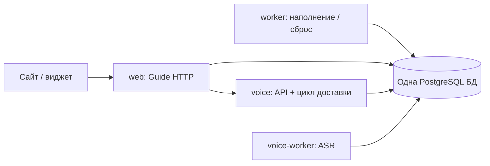

# Voice: один контейнер API/доставки и общая база

Решение владельца: объединить `voice-api` и `voice-consumer` в `voice`, убрать
отдельную БД Voice. Интегрировано с PR #28–30: единая публичная лента, ASR без GPT-анализа,
административное удаление и открытые технические логи.

Пять постоянных контейнеров: `web`, `worker`, `voice`, `voice-worker`, PostgreSQL.
`voice-migrate` и `voice-prepare-model` — одноразовые команды. Образ приложения общий.
Аудио и веса моделей сохраняются в прежних volumes.

## Владение данными

Все процессы используют `DATABASE_URL`. Guide работает в `public` (или настроенной
`DATABASE_SCHEMA`), Voice — в схеме `voice` (`VOICE_DATABASE_SCHEMA`). Это одна база
одного PostgreSQL, а не два инстанса/две базы. У Voice нет fallback search_path в public.
Физическое объединение не добавляет сквозных FK и сохраняет границы владения данными.

Ядро `involta_voice` отвечает за аудио и ASR. Production entrypoint
`involta_guide.infrastructure.voice.runtime:create_app` добавляет к его lifespan
Guide-адаптер доставки в отдельном потоке. Поэтому контейнер `voice` имеет доступ
к обеим схемам. Медленный импорт не блокирует HTTP event loop; ASR остаётся в worker.
Механизмы outbox/inbox, cursor, ACK после commit и content_epoch сохраняются.
При перезапуске неподтверждённые события читаются снова, применение идемпотентно.

Container health проверяет HTTP readiness и состояние доставки. Отдельный
`guide-voice-consumer` больше не запускается. Команда `guide voice-consumer-health`
остаётся проверкой внутреннего компонента, а не отдельного сервиса.

## Остановка

HTTP-серверам задан `--timeout-graceful-shutdown 15`: незавершённая загрузка
не держит завершение бесконечно. Это воспроизведено локальным Docker-тестом:
без лимита недосланное тело оставляло web на `Waiting for connections to close`;
с тестовым лимитом 1s процесс завершался примерно за 1.6s. Это подтверждает
сценарий зависания; наличие именно такого запроса на прошлом production не доказано.

Доставка проверяет stop-event между событиями, ожидание backoff прерывается сразу.
Текущая транзакция заканчивается; HTTP/SQL операции имеют таймауты. На завершение
потока отведено до 65s; превышение явно логируется, незавершённые события остаются
в durable inbox/outbox. `voice` имеет общий grace period 90s. Обычная остановка
без зависшей операции занимает секунды. Worker ASR сохраняет 120s на текущую работу,
Guide worker — 240s. Всем постоянным процессам включён Docker init.

Release посылает stop всем процессам одновременно и ждёт их завершения, сохраняя
индивидуальные grace periods. Прежняя последовательность `240s web + 240s consumer`
удалена. Незавершённое HTTP-тело не считается успешно принятой записью; браузер отправляет каждую запись только один раз; серверная идемпотентность сохраняется.

## Первый переход production

Обычный release выполняет переход под существующим серверным lock:

1. Останавливает все Guide/Voice writers. Исходный `voice-db` ещё работает для чтения.
2. `shared_database` открывает исходную БД read-only, создаёт схему Voice в общей БД,
   переносит все таблицы и последовательности. Все изменения назначения — одна
   транзакция. Контрольные суммы содержимого каждой таблицы должны совпасть.
   Ошибка откатывает создание схемы/копирование целиком; источник не изменяется.
3. При повторе после сбоя между commit и записью конфигурации существующая схема
   только сверяется с источником. Перезапись отличающегося назначения запрещена.
4. Сохраняет приватную копию `.env.voice` в release directory и переводит старый
   `VOICE_DATABASE_URL` на общую БД с `search_path=voice`. Это временный мост для
   предыдущего образа; новые процессы читают только `DATABASE_URL`.
5. Останавливает и удаляет старые контейнеры `voice-db`, `voice-api`, `voice-consumer`.
   Их PostgreSQL volume остаётся резервной копией; аудио-том используется дальше.
6. До обновления Voice 5/6 → 7 сохраняет проверенный pg_dump только схемы `voice`
   в приватный `pre-voice-stream.{deployment_id}.dump`. Перенос копирует исходную версию
   схемы; обновление версии выполняется отдельно, после backup.
7. Применяет Voice v7, запускает `voice` и `voice-worker`, проверяет API/доставку,
   затем web/worker и HTTPS. Guide мигрируется одной цепочкой
   filling_v3 → filling_top3 → review_stream → review_publication.

Rollback использует **Compose snapshot предыдущего релиза вместе с его образом**.
При неудачном обновлении сначала восстанавливаются исходная версия Voice и Guide из снимков
этой операции. Старые API/consumer подключаются к общей БД через совместимый DSN.
Обратно в замороженную отдельную БД запись не возвращается. Восстановление снимка
возвращает данные к моменту остановки writers; поздний откат после начала реальной
работы требует отдельного согласования потери новых записей. При сбое до переноса старый
DSN остаётся прежним. Схема Guide при необходимости восстанавливается штатным
механизмом; снимок включает изменения Guide до миграций тройки и ленты.

Полный `pg_dump` общей БД включает обе схемы; release-backup Guide выбирает только его таблицы. Нельзя восстанавливать
старый snapshot всего кластера поверх новой рабочей БД ради отката только образа.
Удаление старого PostgreSQL volume и временного моста — после отдельной приёмки,
по [LEGACY_REMOVAL.md](LEGACY_REMOVAL.md).

## Публикация отзывов: Voice 6 → 7

Guide получает `reviews.publication_status`: 0 — ошибка, 1 — опубликовано,
2 — резерв модерации. Voice v7 добавляет outbox-событие `gigaam_failed` для старых
терминальных ошибок primary, включая нераспознанное аудио. Нового ASR-вызова нет.
Consumer применяет статус 0, сохраняя сам отзыв, исходное аудио и подробности в логе.
Parakeet не влияет на публичную ленту.

Выпускать Guide, Voice runtime и worker одним SHA через полный release. Старые
writers/consumer останавливаются до миграций; schema-only backup Voice нужен и при
6 → 7, чтобы rollback не оставил новому consumer-протоколу события в старом runtime.
Старый consumer нельзя запускать между миграцией и стартом нового runtime.

## Проверки

`test_shared_voice_database.py`: перенос из прежнего public, события, последовательности,
доступ старого клиента, повтор, атомарный отказ и неизменность источника.
`test_voice_runtime.py`: реальный Uvicorn, общая БД, доставка/перезапуск без дублей,
SIGTERM и недосланные HTTP-тела. `test_service_shutdown.py`: параллельная остановка
через барьер процессов и приватное обновление DSN. `voice_stack_smoke.py`: одноразовый
Compose-стек с синтетическим аудио и fake provider, без платных вызовов.

### Quoted database URL and failed-cutover recovery

The bootstrap writes single-quoted dotenv values. The shared-database bridge
must decode those quotes before adding PostgreSQL `search_path`; otherwise
Compose cannot parse the resulting `.env.voice`, including during rollback.
`shared-database-env.py --check` validates the candidate with the actual Compose
parser before any writers stop. The actual update validates again, uses a private
temporary file, and atomically replaces the env only on success. Credentials and
Compose's resolved configuration never appear in logs.

If an uncommitted cutover has already damaged `.env.voice`, the SSH transport
supports explicit `recover` with `RECOVERY_DEPLOYMENT_ID` set to the failed run's
original `run-attempt`. `TARGET_SHA` and `IMAGE_REF` identify that failed release.
Recovery holds the deployment locks, requires all writers stopped, requires the
original private env and Guide dump, repairs the compatibility URL using the
original env, restores matching database snapshots and starts the recorded prior
release. The successfully consolidated Voice database remains the source of truth;
the old separate database is not selected again. Local and public health checks
must pass. This is an operator recovery action, never an automatic read-only report.

## Бета-сравнение: Voice 7 → 8

Для новых записей выполняются прежние GigaAM/Parakeet через onnx-asr и по два
Sherpa-варианта каждой модели: без словаря и со словарём всех ресторанов города.
Все шесть задач работают **последовательно в прежнем voice-worker**. Первичный
GigaAM имеет приоритет перед сравнением и публикуется сразу после готовности.
Остальные варианты не блокируют его доставку и не подменяют текст. Старые аудио
автоматически не распознаются заново. Дополнительных сервисов и БД нет.

`uv.lock` закрепляет sherpa-onnx за commit
`3898de1380029e96a3b0a3df9e21e3f5ee5eb7fb` с исправлением NeMo TDT #4084.
Публичный релиз 2.0.1 старше этого исправления. Собирается CPU-библиотека из исходников,
компиляторы остаются только в builder-стадии Docker; на VPS ставится готовый образ.
CI timeout увеличен для нативной сборки. Образ проверяет commit_id из PEP 610
`direct_url.json`, а не `sherpa_onnx.git_sha1`: upstream version.cc в закреплённом
коммите по-прежнему содержит старую строку SHA. Оба значения сохранены в диагностике.

`voice prepare-model` загружает также совместимые экспорты Sherpa по точным
Hugging Face commit SHA. Имеющиеся onnx-asr веса/ревизии/параметры не меняются.
BPE-словарь подсказок создаётся детерминированно из tokens.txt (алгоритм записан
в request). Воркер работает offline и загружает одну тяжёлую ASR-модель за раз.
Список названий сам по себе мал; время на весь набор увеличивается из-за четырёх
дополнительных распознаваний. Фактическую память/скорость измерять на выбранном VPS.

Порядок выпуска: собрать/проверить образ → штатный полный release, который
останавливает writers, сохраняет Voice schema dump для версий <8, применяет
`voice migrate` (8), выполняет `voice prepare-model`, запускает все компоненты
из одного SHA. Guide Alembic остаётся review_publication. Production Compose
явно включает полный профиль беты в voice, voice-worker и voice-prepare-model;
отдельного выключенного Sherpa-флага нет.

При первом выпуске понадобится место и время для новых весов (~0.9 GB, точный
размер зависит от файловых метаданных). Нельзя сначала пустить новые задания,
а подготовку моделей оставить на потом. Проверить готовность API (schema 8),
heartbeat воркера, шесть результатов нового отзыва и сохранённый словарь в админке.
Откат неудачной операции восстанавливает исходную Voice-схему из её backup перед
запуском старого образа. После возобновления реального приёма правила согласованного
отката с сохранением новых записей прежние.
