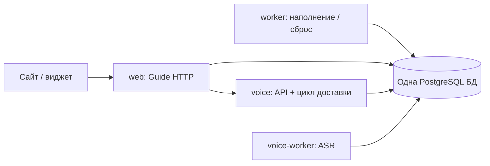

# Voice: один контейнер API/доставки и общая база

Решение владельца: объединить `voice-api` и `voice-consumer` в `voice`, убрать
отдельную БД Voice. Интегрировано с PR #28–30: единая публичная лента, ASR без GPT-анализа,
административное удаление и открытые технические логи.

Пять постоянных контейнеров: `web`, `worker`, `voice`, `voice-worker`, PostgreSQL.
`voice-migrate` и `voice-prepare-model` — одноразовые команды. Образ приложения общий.
Аудио и веса моделей сохраняются в прежних volumes.

## Владение данными

Все процессы используют `DATABASE_URL`. Guide работает в `public` (или настроенной
`DATABASE_SCHEMA`), Voice — в схеме `voice` (`VOICE_DATABASE_SCHEMA`). Это одна база
одного PostgreSQL, а не два инстанса/две базы. У Voice нет fallback search_path в public.
Физическое объединение не добавляет сквозных FK и сохраняет границы владения данными.

Ядро `involta_voice` отвечает за аудио и ASR. Production entrypoint
`involta_guide.infrastructure.voice.runtime:create_app` добавляет к его lifespan
Guide-адаптер доставки в отдельном потоке. Поэтому контейнер `voice` имеет доступ
к обеим схемам. Медленный импорт не блокирует HTTP event loop; ASR остаётся в worker.
Механизмы outbox/inbox, cursor, ACK после commit и content_epoch сохраняются.
При перезапуске неподтверждённые события читаются снова, применение идемпотентно.

Container health проверяет HTTP readiness и состояние доставки. Отдельный
`guide-voice-consumer` больше не запускается. Команда `guide voice-consumer-health`
остаётся проверкой внутреннего компонента, а не отдельного сервиса.

## Остановка

HTTP-серверам задан `--timeout-graceful-shutdown 15`: незавершённая загрузка
не держит завершение бесконечно. Это воспроизведено локальным Docker-тестом:
без лимита недосланное тело оставляло web на `Waiting for connections to close`;
с тестовым лимитом 1s процесс завершался примерно за 1.6s. Это подтверждает
сценарий зависания; наличие именно такого запроса на прошлом production не доказано.

Доставка проверяет stop-event между событиями, ожидание backoff прерывается сразу.
Текущая транзакция заканчивается; HTTP/SQL операции имеют таймауты. На завершение
потока отведено до 65s; превышение явно логируется, незавершённые события остаются
в durable inbox/outbox. `voice` имеет общий grace period 90s. Обычная остановка
без зависшей операции занимает секунды. Worker ASR сохраняет 120s на текущую работу,
Guide worker — 240s. Всем постоянным процессам включён Docker init.

Release посылает stop всем процессам одновременно и ждёт их завершения, сохраняя
индивидуальные grace periods. Прежняя последовательность `240s web + 240s consumer`
удалена. Незавершённое HTTP-тело не считается успешно принятой записью; браузер отправляет каждую запись только один раз; серверная идемпотентность сохраняется.

## Первый переход production

Обычный release выполняет переход под существующим серверным lock:

1. Останавливает все Guide/Voice writers. Исходный `voice-db` ещё работает для чтения.
2. `shared_database` открывает исходную БД read-only, создаёт схему Voice в общей БД,
   переносит все таблицы и последовательности. Все изменения назначения — одна
   транзакция. Контрольные суммы содержимого каждой таблицы должны совпасть.
   Ошибка откатывает создание схемы/копирование целиком; источник не изменяется.
3. При повторе после сбоя между commit и записью конфигурации существующая схема
   только сверяется с источником. Перезапись отличающегося назначения запрещена.
4. Сохраняет приватную копию `.env.voice` в release directory и переводит старый
   `VOICE_DATABASE_URL` на общую БД с `search_path=voice`. Это временный мост для
   предыдущего образа; новые процессы читают только `DATABASE_URL`.
5. Останавливает и удаляет старые контейнеры `voice-db`, `voice-api`, `voice-consumer`.
   Их PostgreSQL volume остаётся резервной копией; аудио-том используется дальше.
6. До обновления Voice 5 → 6 сохраняет проверенный pg_dump только схемы `voice`
   в приватный `pre-voice-stream.{deployment_id}.dump`. Перенос копирует исходную версию
   схемы; обновление версии выполняется отдельно, после backup.
7. Применяет Voice v6, запускает `voice` и `voice-worker`, проверяет API/доставку,
   затем web/worker и HTTPS. Guide мигрируется одной цепочкой filling_v3 → filling_top3 → review_stream.

Rollback использует **Compose snapshot предыдущего релиза вместе с его образом**.
При неудачном обновлении сначала восстанавливаются Voice v5 и Guide из снимков
этой операции. Старые API/consumer подключаются к общей БД через совместимый DSN.
Обратно в замороженную отдельную БД запись не возвращается. Восстановление снимка
возвращает данные к моменту остановки writers; поздний откат после начала реальной
работы требует отдельного согласования потери новых записей. При сбое до переноса старый
DSN остаётся прежним. Схема Guide при необходимости восстанавливается штатным
механизмом; снимок включает изменения Guide до миграций тройки и ленты.

Полный `pg_dump` общей БД включает обе схемы; release-backup Guide выбирает только его таблицы. Нельзя восстанавливать
старый snapshot всего кластера поверх новой рабочей БД ради отката только образа.
Удаление старого PostgreSQL volume и временного моста — после отдельной приёмки,
по [LEGACY_REMOVAL.md](LEGACY_REMOVAL.md).

## Проверки

`test_shared_voice_database.py`: перенос из прежнего public, события, последовательности,
доступ старого клиента, повтор, атомарный отказ и неизменность источника.
`test_voice_runtime.py`: реальный Uvicorn, общая БД, доставка/перезапуск без дублей,
SIGTERM и недосланные HTTP-тела. `test_service_shutdown.py`: параллельная остановка
через барьер процессов и приватное обновление DSN. `voice_stack_smoke.py`: одноразовый
Compose-стек с синтетическим аудио и fake provider, без платных вызовов.
