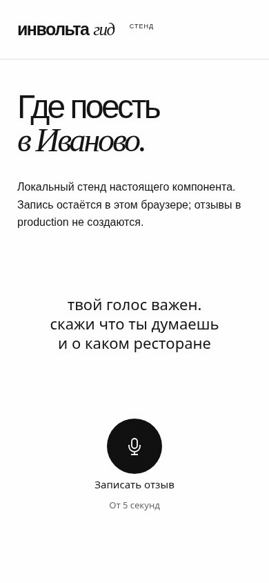
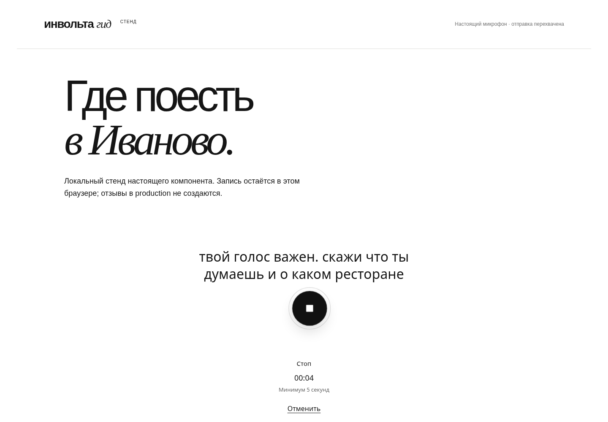
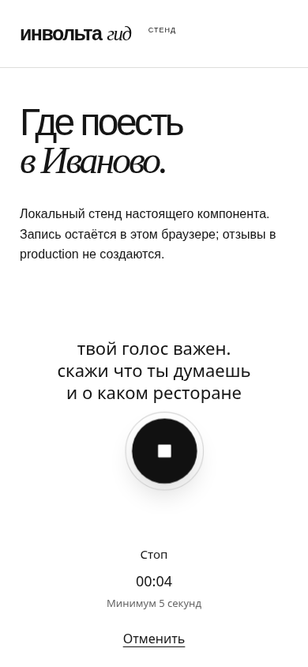
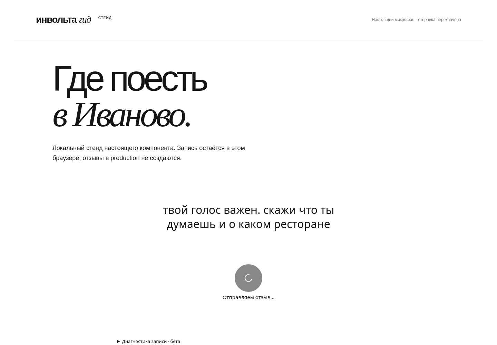
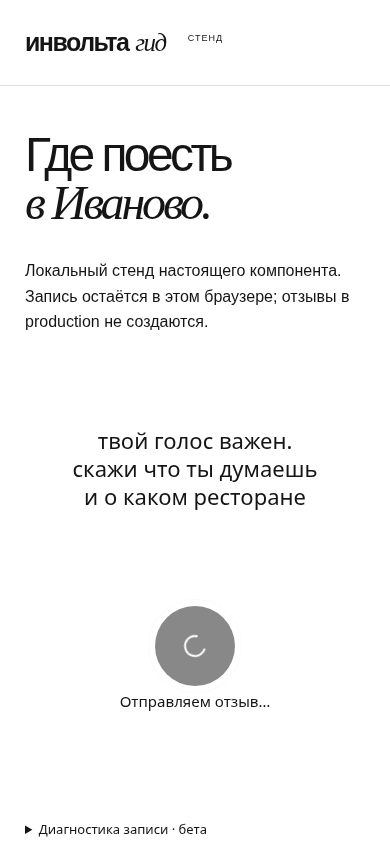
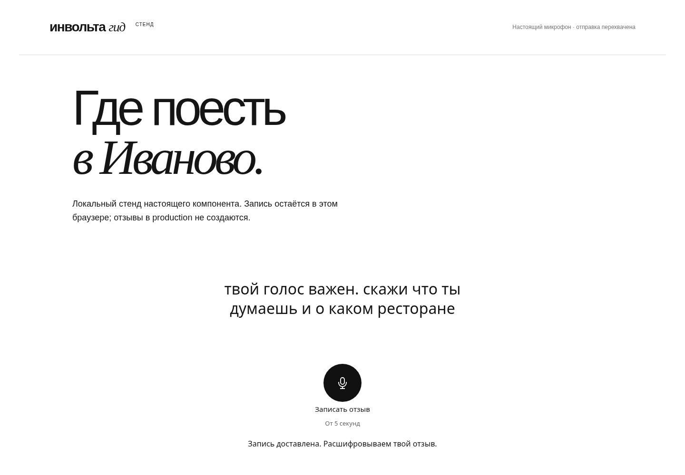
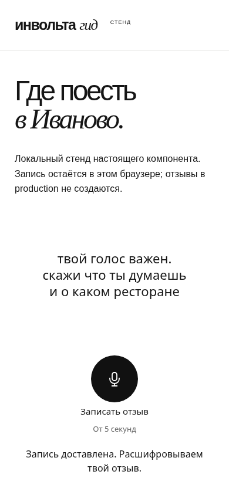

# Голосовой виджет: реализация и проверка

Актуальное поведение по решению владельца от 04.11.2026: касание микрофона →
запись → ручной стоп/автостоп → автоматический upload. Плеера, отдельной отправки,
перезаписи и состояния preview нет. Смысл записи виджет не фильтрует.

База — main `67c1db6` с упрощённой архитектурой беты и content_epoch. Один существующий
SDK в Shadow DOM, один элемент управления на странице. Backend, ASR/анализ,
модерация, схемы БД и серверные контракты в этой правке не меняются.

## Проверить на стенде

```sh
python tools/voice-widget-demo.py --port 33091
```

Открыть http://localhost:33091/guide/ivanovo с микрофоном. Нужен localhost либо
собственный HTTPS. SDK, MediaRecorder, AudioContext и локальный Silero настоящие;
upload перехватывается в браузере, Guide/Voice worker/ASR/OpenAI не вызываются.
Демонстрационная расшифровка подписана. Переключатель под виджетом позволяет
проверить успех, HTML 502, потерянный ответ после принятия, отказ по длине и сбой VAD.

После штатного стопа запись сама отправляется в mock. На ошибке тот же кружок
показывает «Повторить отправку». Reload восстанавливает аудио и прежний ключ для
повтора, без автоматической отправки при открытии страницы. При 422 по длине
повтор запрещён, остаются скачивание в диагностике и микрофон для нового отзыва.
Плеера нет ни в нормальном сценарии, ни при восстановлении/ошибке.

## Управление и гарантии

- Круглый микрофон 80 px / SVG 28 px, центр основной доступной ширины; дословная
  просьба постоянно над ним. Во время записи на том же button появляется стоп.
- Запуск по pointerdown без искусственных задержек. Изначальный pointerup/click
  не нажимает стоп; Enter/Space и screen reader также выполняют одно действие.
- Голубая браузерная подсветка отключена внутри Shadow DOM. Только на кружке
  touch-action: none и запрет выделения/callout; страница вокруг скроллится.
- Pointer capture сохраняет исходный жест за пределами круга. Движение вверх
  возможно сразу или после нескольких секунд удержания; одна запись продолжается.
- Круг следует transform с сопротивлением (вверх 80 px, в стороны 36, вниз 16),
  лёгкой тенью/увеличением, возвращается за 240 мс. Зазор 64 px защищает просьбу;
  текст/таймер не прыгают. Reduced motion отключает пружину/масштабирование.
- Ручной стоп, тишина, no-speech и 120 с финализируют/сохраняют/отправляют запись.
  Отмена не отправляет; системное прерывание/unmount сохраняет допустимую запись
  для восстановления, без фонового upload. Повреждённый/усечённый файл не отправляется.
- Минимум 5000 мс от события recorder.start до запроса stop. Разрешение и кодирование
  не добавляют время; 4,999 не округляется. Существующий backend тоже требует 5 с.
- Одна финализация, один recorder/автоматический POST. Пока upload выполняется,
  кнопка отключена. Поздний статус прежнего отзыва не перезаписывает новую запись.
- Перед upload — попытка сохранить blob/key/epoch в прежнем IndexedDB. При сетевой
  ошибке/HTML/неизвестном результате они сохраняются; повтор использует тот же ключ.
  Успех — подтверждение устойчивого сохранения сервером, после него очередь очищается.
- Известный отказ по длине помечается атомарно по id и сохраняется при reload,
  предотвращая повтор заведомо невалидного файла. Скачивание остаётся в диагностике.
- Content_epoch не переименовывается: reset удаляет старое намерение. Cleanup не
  стирает чужую/более новую локальную запись. Старые отзывы/аудио/логи не удаляются.
- Поздние streams/events игнорируются токеном попытки. Tracks, AudioContext,
  VAD/worklet, timers, capture и object URLs освобождаются. Закрытие процесса браузера
  во время незавершённого кодирования не гарантирует восстановление.

## VAD и диагностика

Silero v5, @ricky0123/vad-web 0.0.30, onnxruntime-web 1.22.0. Все assets и ISC/MIT
лицензии лежат в src/involta_voice/static/vad, manifest.json содержит integrity,
SHA256/размеры/источники. Проверяются без npm и без runtime CDN:

```sh
python tools/vendor-voice-vad.py
python tools/vendor-voice-vad.py --restore # восстановить точные версии из npm
```

Десять файлов/лицензий, 13,68 MB без сжатия; модель 2,33 MB, WASM 11,21 MB.
Раздача с нашего origin через /BASE_PATH/voice/vad в Guide и /vad в Voice.
COOP/CSP не менялись, WASM однопоточный, SharedArrayBuffer не требуется.

Recorder стартует до анализа, тот же stream. 400 мс положительных кадров для
подтверждения речи; positive 0.3 / negative 0.25. Предупреждение на 4,5 с тишины,
стоп на 5 с; no-speech на 8 с обработанного потока после готовности. Unknown/новая
речь сбрасывают паузу. Lag, отсутствие кадров, suspended context, ошибка/таймаут
загрузки 12 с отключают только автостоп. RMS — только визуальный уровень.
Все исходные чанки сохраняются. VAD не задерживает начало записи и не решает,
должен ли голосовой стать отзывом.

Существующая сворачиваемая бета-диагностика сохраняет HTTP статус/тело/тайминги,
локальное скачивание и серверный журнал. Добавлены capture/VAD timeline,
gesture_start/gesture_end, причина и длительность удержания. Каждый кадр движения
в журнал не пишется. Аудио/секреты в консоль не выводятся; cookies/CSRF маскируются.

## Проверки

Локально: **30 браузерных тестов** UX/native MediaRecorder; Ruff/format/mypy,
node --check и проверка pinned assets. Полный CI актуального HEAD указан в PR.

Проверено: границы 4,999/5,000/5,001; отдельный минимум backend сохранён; удержание
0/3/7 с и движение вверх; скролл вне кнопки; одна автоотправка после стопа/VAD/лимита;
отсутствие audio/старых кнопок во всех состояниях; native финальные чанки; HTML 502,
reload, lost accepted response и прежний ключ; старое короткое аудио и persisted 422;
позднее разрешение, capture loss, unmount до POST; отмена при удержании; reduced motion;
reset/content_epoch и поздний статус предыдущего отзыва.

Стенд: Chromium 154/Linux с синтетическим русским input (не личная запись).
Настоящий MediaRecorder/Silero, удержание → движение вверх → отпускание → стоп →
один mock upload. Скриншоты/анимация пересняты для текущего UI; для видимости
upload при съёмке его mock-ответ задержан, это не замер реальной сети.

Физические Android Chrome/Opera и iPhone Safari, desktop Firefox/Safari,
настоящие кафе/музыка/тихий голос, системные звонки и слуховая оценка первых/последних
фонем в этом окружении не проверены. Мобильный viewport не является телефоном.

## Скриншоты настоящего компонента стенда



| Состояние | 1440×1000 | 390×844 |
| --- | --- | --- |
| Ожидание |  |  |
| Запись |  |  |
| Движение вверх |  |  |
| Отправка |  |  |
| Подтверждение |  |  |
