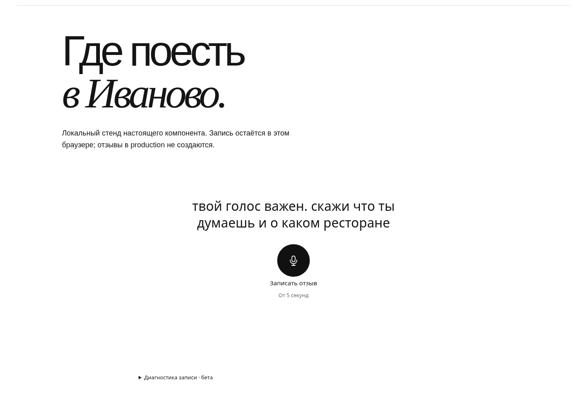
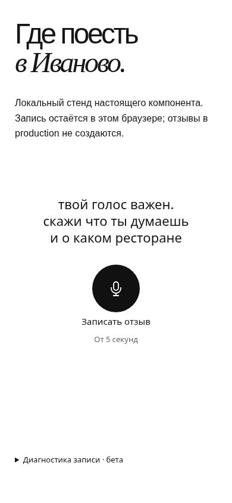
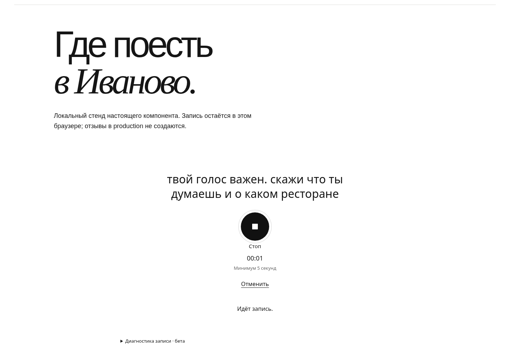
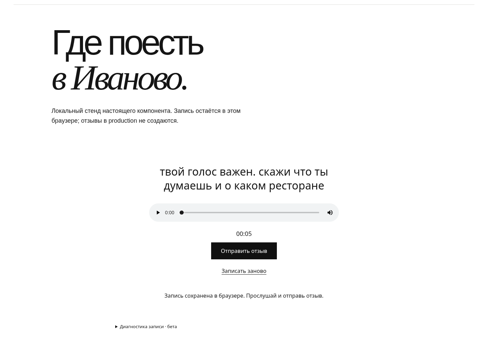
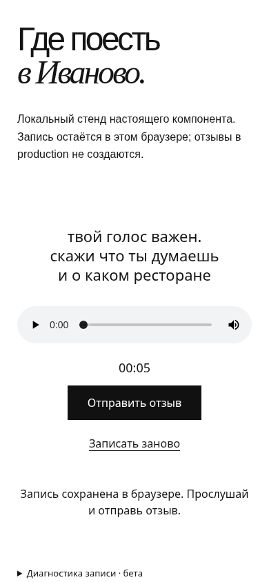

# Проверка нового голосового виджета

Реализация `VOICE_WIDGET_UX_SPEC.md` от main `383c406`: обычное нажатие микрофона,
стоп на том же месте, прослушивание и отдельная отправка. Никаких hold/swipe/lock
режимов. Основная просьба дословно остаётся над управлением во всех состояниях.
Один SDK и один виджет на странице локации; standalone embed сохранён.

## Стенд без production и платных вызовов

```sh
python tools/voice-widget-demo.py --port 33090
```

Открыть http://localhost:33090/guide/ivanovo в браузере с микрофоном. Нужен localhost
либо собственный HTTPS; произвольный HTTP-хост не даёт доступ к микрофону.
Стенд использует настоящий SDK, MediaRecorder, AudioContext и локальный Silero VAD.
Upload перехватывается в браузере: Guide, Voice worker, ASR и OpenAI не вызываются.
Тестовая расшифровка явно обозначена как демонстрация.

Под виджетом раскрываются управление стендом и варианты ответа: успех, HTML 502,
потерянный ответ после принятия, `audio_too_short`, недоступность модели VAD.
В диагностике самого компонента — относительные времена press, разрешения,
запуска recorder, stop, готовности blob и upload; причина стопа, состояние VAD,
речь/паузы, байты/MIME/длительность, полный ответ и локальное скачивание.
Аудио не печатается в консоль. Сессионные cookies и CSRF исключаются из отчёта.

## Гарантии

- Pointerdown запускает одно намерение записи без искусственной задержки.
  Его pointerup/click не нажимает появившийся стоп. DOM-узел кнопки сохраняется.
  Enter/Space и screen-reader click поддерживаются; autorepeat подавлен.
- Кнопка 80 px, SVG 28 px, центр внутри доступной ширины страницы/контейнера.
  Речь управляет только неброской волной уровня; reduced motion отключает анимацию.
- Таймер считает монотонное время от события старта MediaRecorder до запроса stop;
  ожидание разрешения и финализация кодека в минимум не входят. Кодек не дополняется
  тишиной. Запись короче 5000 мс удаляется до сохранения нового draft/upload.
- Одна финализация, один активный recorder на страницу. Токен попытки защищает
  от позднего разрешения и событий отменённой записи. Отмена не стирает чужой draft.
- Сервер измеряет реальное аудио ffprobe: длительность аудиопотока и декодированных
  аудиокадров, без завышения на encoder padding. Новый отзыв требует ≥5 секунд.
  Ошибка — 422 `audio_too_short`, `min_duration_seconds: 5`, измеренная длительность.
  Нет submission/очереди/постоянного короткого файла. Gateway сохраняет ответ.
- Ранее принятые короткие записи повторяются по прежнему ключу до новой проверки
  длительности. Внутренние ASR-импорты сохраняют прежний минимум; OutboxEvent.duration
  по-прежнему читает старые события от одной секунды. Миграций нет.
- IndexedDB, blob/key при сетевой ошибке, повтор без дубля, история и диагностика
  сохранены. Серверный отказ по длительности оставляет скачивание/перезапись,
  блокируя повтор заведомо короткого файла. Старый короткий draft тоже не отправляется.
- Pagehide/unmount останавливают микрофон без upload; допустимый финализированный
  draft сохраняется по возможности. Восстановление оборванного кодирования при
  закрытии процесса браузера не гарантируется.

## Локальный VAD

Поставляются **@ricky0123/vad-web 0.0.30**, **Silero v5**, **onnxruntime-web 1.22.0**.
ISC/MIT лицензии, точные npm integrity и SHA256 каждого файла находятся в
`src/involta_voice/static/vad/manifest.json`. Общий размер файлов — 13,68 MB
без HTTP-сжатия; модель около 2,33 MB, WASM около 11,21 MB.

```sh
python tools/vendor-voice-vad.py           # только локальная проверка хешей
python tools/vendor-voice-vad.py --restore # восстановление точных версий из npm
```

Модель, JS, worklet, WASM/MJS доступны с нашего origin через `/BASE_PATH/voice/vad/`
в Guide и `/vad/` в standalone Voice. Runtime CDN отсутствует; COOP/CSP сайта
не менялись. WASM работает в одном потоке без требования SharedArrayBuffer.
Проверено включение всех десяти файлов/лицензий в wheel; сборка wheel — около 5,1 MB.

В серверном журнале отправки сохраняются также browser timeline и VAD-диагностика,
без аудиокадров; доступ к записи и маскирование секретов остаются прежними.

Recorder стартует до анализа. AudioContext/VAD инициализируются после первого
кадра управления, используя тот же stream. Речь подтверждается 400 мс положительных
кадров, positive 0.3 / negative 0.25. Результаты неопределённости сбрасывают паузу.
Предупреждение — после 4,5 с, стоп — после 5 с обработанной непрерывной тишины.
Задержанный `onSpeechEnd` библиотеки не используется. Без речи — стоп после 8 с
обработанного потока после готовности VAD. Recorder сохраняет все исходные чанки.

Кадры считаются по длине PCM; wall clock проверяет отставание и пропуски. Зависание,
ошибка, suspended context или загрузка дольше 12 с отключают только автостоп,
показывая ручной fallback. До готовности VAD отсутствующие кадры не считаются тишиной.
Стоп по 120 с и лимит 10 MiB не зависят от VAD. Автоматической отправки нет.
Для отмены во время инициализации учтена особенность destroy в vad-web 0.0.30:
при ещё не созданном graph освобождается уже загруженная model session.

## Выполненные проверки

- Полный локальный набор: 333 теста прошли до добавления отдельной проверки
  ожидания разрешения; актуальный полный результат фиксируется в CI PR.
- Детерминированные часы и VAD: 4,999/5,000/5,001, пауза 4,5/5 с, возврат речи,
  неопределённость, no-speech, lag/fallback, максимум, pointer/keyboard, два embed,
  поздний stream, отмена, одна финализация, unmount и восстановление.
- Настоящий MediaRecorder: финальные чанки, preview, HTML 502, reload/IndexedDB,
  потерянный ответ и повтор с прежним ключом, освобождение tracks/object URLs.
- Backend: WAV/WebM/Ogg/MP4 на границах, cleanup коротких файлов, единый путь
  приёма посетителя и администратора через Voice, повтор прежней двухсекундной записи и доставка её события.
- Скриншоты 1440×1000 и 390×844: центр круга в пределах 1 px от оси viewport,
  одна позиция/размер в idle/recording, отсутствие горизонтальной прокрутки.

### Наблюдения стенда, не замеры телефонов

Chromium 154 на Linux, автоматическое разрешение и тестовый audio input. Десять
коротких циклов. `controls_painted` — ближайший rAF после смены DOM, прокси отклика,
а не измерение физических пикселей дисплея. p95 здесь описательный при n=10.

| Интервал | p50, мс | p95, мс |
| --- | ---: | ---: |
| Press → rAF управления | 11 | 13 |
| Press → разрешение/stream (автоматическое разрешение) | 16 | 44,4 |
| Press → событие старта recorder | 76 | 104,95 |
| Recorder.start() → событие start | 59 | 60 |

Два снимка с настоящим recorder и локальным VAD: готовность VAD через 570/616 мс
от press; stop → готовый blob через 15/16 мс. Это localhost на том же Linux,
мобильный viewport не является телефоном. Внешних HTTP-запросов не было.

На синтетическом русском аудио (espeak, не реальный пользователь) длительностью
9,127 с с добавленной тестовой паузой: подтверждение речи, предупреждение и
автостоп по тишине; preview без upload. В отдельном 14,8-секундном прогоне доля
TaskDuration основного потока вкладки — около 9% одного ядра, включая холодную
инициализацию, UI и RMS. Это не полный CPU всех процессов/устройств.

### Осталось ручное бета-тестирование

Физические Android Chrome, iPhone Safari, desktop Firefox и Safari недоступны
в этом окружении и не проверены. Не проверены настоящая запись в кафе, музыка,
тихий голос, системный звонок и слуховая оценка первых/последних фонем на этих
устройствах. Детерминированные fixtures проверяют защитное поведение, не качество
детектора в таких условиях. На медленной первой загрузке VAD может не успеть
за фразой; ручной стоп и прослушивание доступны, автоотправки нет.

## Скриншоты реального компонента на стенде

| | Широкая страница | Мобильная ширина |
| --- | --- | --- |
| Idle |  |  |
| Запись |  |  |
| Прослушивание |  |  |

## Совмещение с упрощением ядра (PR20)

Виджет использует обычный Voice для всех пользователей; старый Guide ReviewService
и редакторский путь не возвращаются. Минимум 5 секунд проверяется внутри защищённого
приёма Voice после проверки исходного content_epoch и идемпотентности. Имена файлов
сохраняют владельца/epoch, поэтому полный reset находит и удаляет их.

Каждая запись и её IndexedDB draft сохраняют исходный content_epoch. Identity
проверяется при начале записи и перед отправкой; микрофон запрашивается сразу
из пользовательского нажатия, параллельно получению epoch. Смена цикла или ответ
stale_epoch очищают старую попытку без переприсвоения нового epoch. Диагностика
также привязана к локации/epoch. Локальный стенд использует тот же контракт.

Добавлены браузерные проверки сброса перед отправкой и во время запроса; сохранены
проверки reload, старого IndexedDB draft, нового сознательного отзыва после reset,
минимальной длины и сохранения timeline/VAD в серверной диагностике. Приведённые
выше измерения задержек относятся к исходному стенду PR19 до совмещения; сетевое
ожидание epoch на production отдельно не измерено.
