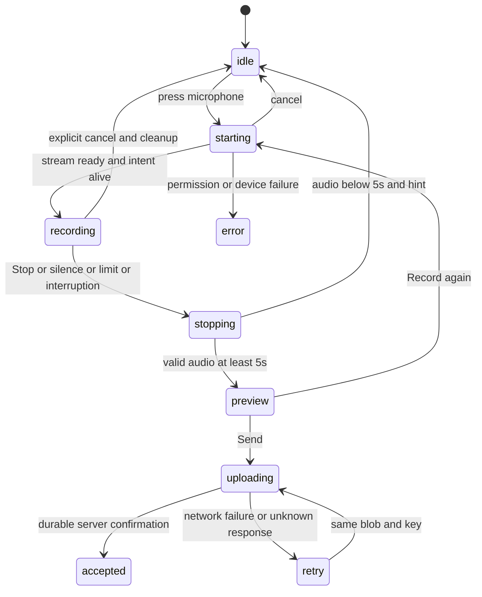

# Голосовой виджет: центральная кнопка микрофона → стоп → отправить

**Статус: самостоятельное ТЗ для Sol. Реализация в отдельной ветке и PR; деплой отдельно.**
Обновлено: 2026-11-03. Проверенная база документа: main `8ea7e29`.

## 1. Решение владельца и границы задачи

Сделать простой, красивый голосовой ввод на странице локации:

**Нажал круглый микрофон → говоришь → нажал появившийся на его месте стоп →
прослушал → отправил.** Удерживать кнопку не требуется. Отпускание ничего не
останавливает и не отправляет. Запись продолжается до стопа, автостопа или отмены.

Этот документ полностью заменяет прежнюю редакцию `VOICE_WIDGET_UX_SPEC.md`.
Не реализовывать прежний набор жестов: тап/hold, свайп вверх к замку, свайп влево,
отправку при отпускании, Android-пороги 150/50 мс и координатные формулы.
Telegram остаётся ориентиром быстрого отклика и понятного состояния; копировать
сложность его жестов для текущего сценария не нужно. У нас один режим записи.

Главная функция — сохранить конкретный текстовый отзыв о ресторане. Пользователь
находится на странице города/локации: название ресторана он произносит, город
известен из страницы. Не добавлять обязательный выбор ресторана перед записью.
Предложения изменений и модерация выполняются существующим backend.

Сохранить решения [ТЗ упрощения беты](BETA_CORE_SIMPLIFICATION_SPEC.md), если они
уже внедрены в свежем main: обычный отзыв, без редакторского голоса, защита от
устаревшей отправки после очистки локации. Архитектурный PR может идти параллельно:
не выполнять его заново, не возвращать удалённые им роли, таблицы или маршруты.

Входит: внешний вид виджета, события кнопки, состояния записи, минимум 5 секунд
на frontend/backend, локальная остановка по тишине, проверки и стенд.
Не входит: ASR-движки, анализ отзыва, модерация, ранжирование, админка, миграция БД,
новые сервисы/очереди, production-деплой.

## 2. Внешний вид и постоянная просьба

Главный текст **дословно**, постоянно над управлением:

> твой голос важен. скажи что ты думаешь и о каком ресторане

Он виден во всех состояниях: ожидание разрешения, запись, прослушивание,
отправка, ошибка, повтор, успешная доставка, показ расшифровки. Не скрывать его
при смене состояния, не заменять таймером/ошибкой, не прятать под раскрытие.
Переменные сообщения размещаются отдельно ниже. При прокрутке страницы виджет
остаётся в потоке документа: sticky/fixed к экрану не требуется.

Композиция:

- Белый фон, чёрная типографика, много свободного места. Без отдельной тяжёлой
  карточки с рамкой, декоративных градиентов, цветных плашек и лишних вступлений.
- Круглая чёрная кнопка, белый векторный микрофон. Стартовый диаметр 80 CSS px,
  иконка около 28 px. Настоящий SVG, не emoji; размеры проверить на мобильном.
- Кнопка стоит **на центральной вертикальной оси страницы**, по центру доступной
  ширины экрана, а не у левого края текста или в углу блока. На странице локации
  дать виджету отдельную полноширинную строку основного контента с симметричными
  отступами. В standalone embed центрировать внутри предоставленного контейнера.
  Не использовать хаки с 100vw, вызывающие горизонтальную прокрутку.
- Просьба центрирована над кнопкой, ширина строки ограничена для читаемости;
  на телефоне текст естественно переносится, целиком остаётся видимым.
- В idle под кнопкой короткая подпись «Записать отзыв», ниже «От 5 секунд».
  Убрать «Нажми или удерживай» и старое длинное вступление.
- Во время записи круг остаётся на том же месте и того же размера. Микрофон
  заменяется белым квадратом стопа; подпись меняется на «Стоп». Это та же
  основная кнопка, а не ещё одна конкурирующая рядом.
- Под кнопкой таймер `00:03`; до минимума рядом/ниже «Минимум 5 секунд».
  После 5 секунд эта служебная подсказка исчезает. Основная просьба остаётся.
- Неброская тонкая пульсация/волна вокруг круга показывает уровень звука.
  Она не сдвигает вёрстку, не управляет записью и не мешает нажать стоп.
  Не показывать активную запись, пока recorder не стартовал.
- Во время записи небольшая отдельная текстовая кнопка «Отменить» под таймером.
  Отмена — явная кнопка, никаких скрытых жестов.
- Во время ожидания разрешения круг показывает ожидание, отдельно доступны
  «Отменить» и статус «Разреши доступ к микрофону». Таймер не идёт.
- После стопа — центрированное прослушивание, явная «Отправить отзыв» и вторичная
  «Записать заново». До отправки запись остаётся локальной. Во время записи
  отдельной кнопки отправки нет: сначала стоп, затем отправка.
- После отправки оставить просьбу и показать результат/расшифровку ниже;
  возможность нового отзыва сохранить. Диагностика появляется по необходимости,
  не занимает весь idle-экран и не вытесняет просьбу.

Схема расположения (значки условные, в реализации SVG):

```text
           твой голос важен. скажи что ты думаешь
                     и о каком ресторане

 idle                    запись                   после стопа
   ◉                        ◼                   ▶ ─────── 00:12
 микрофон                  Стоп                  Отправить отзыв
Записать отзыв             00:07                 Записать заново
 От 5 секунд              Отменить
```

Это последовательные состояния **одного** центрированного виджета, не три колонки.
Сохранить размеры области управления при переключениях, чтобы кнопка не прыгала.

## 3. События и точное поведение

| Действие / событие | Результат |
| --- | --- |
| Нажал микрофон | Сразу видимый отклик, запрос микрофона; запись начинается при готовом stream |
| Отпустил палец/мышь через 0,1 / 0,5 / 3 секунды | Запись продолжается; длительность нажатия ничего не переключает |
| Нажал появившийся стоп отдельным нажатием | Немедленно остановить, финализировать файл, проверить длину |
| Допустимый файл ≥5 секунд | Показать прослушивание и «Отправить отзыв» |
| Запись <5 секунд | Остановить, удалить короткую попытку, вернуть микрофон и подсказку |
| Нажал «Отправить отзыв» | Один upload с существующей защитой повторов |
| Нажал «Записать заново» | Явно заменить текущий локальный draft и начать новую запись |
| Нажал «Отменить» / Escape | Удалить текущую попытку и выключить микрофон; без отправки |
| После речи 5 секунд тишины | Автостоп, та же проверка длины; **без автоматической отправки** |
| 120 секунд записи | Автостоп в прослушивание, без автоматической отправки |
| Ошибка сети / потерянный ответ | Сохранить допустимый blob и тот же ключ для повтора |

Для мыши/касания стартовать по `pointerdown` основной кнопки (primary pointer,
левая кнопка мыши), без искусственного ожидания 150/50/200 мс. `getUserMedia`
вызывать из пользовательского действия, не заранее. Звук нельзя записать до
получения разрешения/stream; показывать ожидание честно. Цель визуального
отклика — до 50 мс на контрольном устройстве, а не обязательная задержка.

**Один физический жест — одно действие.** Исходный `pointerup` и синтетический
`click` после стартовавшего `pointerdown` не нажимают появившийся стоп. Стоп
обрабатывается следующим отдельным нажатием. Сохранить DOM-узел основной кнопки,
не подменять его под пальцем. Быстрый двойной тап может остановить короткую запись,
но никогда не создаёт два recorder или upload. Во время starting повторный старт
игнорировать; отмена доступна отдельной кнопкой.

Использовать обычный `<button>` с доступными именами «Записать отзыв» / «Остановить
запись». Enter/Space и screen-reader activation тоже выполняют ровно одно действие:
не терять клавиатурный `click`, подавляя только дубликат pointer-активации.
Key autorepeat не должен многократно стартовать/останавливать. Не отключать
прокрутку страницы: `touch-action` задаётся локально, без обработчиков свайпов,
перетаскивания кнопки или глобального preventDefault.

Если ввод системно прерван (`pointercancel`, track.ended, звонок, скрытие вкладки),
не отправлять автоматически: отменить ещё не стартовавшее намерение либо остановить
активную запись с проверкой длины. Возврат после прерывания не возобновляет запись
сам собой. Позднее разрешение после отмены не включает микрофон.

## 4. Минимум 5 секунд

Минимум — `5000 ms` **фактического аудио**, не длительность удержания, ожидания
разрешения или обработки. UI использует монотонное время от старта recorder
до запроса stop, а не до onstop/завершения кодирования. Не округлять 4,999 в 5
для допуска. Сервер независимо проверяет файл существующим ffprobe.

При короткой записи сразу остановить микрофон, финализировать для освобождения
ресурсов и удалить blob/object URL/локальный draft **этой** попытки. Не доснимать
до 5 секунд, не дополнять тишиной, не склеивать обрывки. Показать под управлением:

> Слишком коротко. Запиши хотя бы 5 секунд: назови ресторан и расскажи, что думаешь.

Основная просьба остаётся на месте. Ноль upload/submission/ASR-заданий. Локальный
trace `too_short` без аудио допустим на стенде. Явная отмена всегда удаляет попытку
без этой подсказки: пользователь сам отменил, ошибки нет.

Минимум — общий хронометраж, не пять секунд непрерывной речи. Он не гарантирует
полезность отзыва. VAD не определяет ресторан и не оценивает смысл. Короткая пауза
между словами не обнуляет таймер. Проверить границы на WebM/MP4/Ogg, не лечить
расхождение таймера и кодека искусственной тишиной.

Backend для **новых отзывов** проверяет `duration >= 5.0` до создания submission,
очереди, вызова ASR/ИИ; короткие временные файлы удаляются. Прямой HTTP POST и
старый frontend не обходят правило. Ответ: 422, `audio_too_short`, понятный текст,
`min_duration_seconds: 5`. Guide gateway сохраняет код/статус ошибки.

Точки изменения: `src/involta_voice/storage.py`, `service.py`, при необходимости
контракты и `src/involta_guide/web/routes/voice.py`; сверить со свежим main.
Не повышать вслепую `OutboxEvent.duration` с `ge=1` на `ge=5`: старые уже принятые
события должны читаться. Повтор принятого запроса возвращает прежний результат
по ключу; проверка нового приёма не ломает старую доставку. Внутренние ASR beta
импорты и старые отзывы не удалять и не мигрировать в рамках задачи.

Если frontend допустил файл, а backend отверг длину, показать причину и предложить
перезапись. Не повторять автоматически заведомо невалидный upload. Сохранить такой
blob для локального прослушивания/скачивания в диагностике. Старый неотправленный
IndexedDB draft <5 с не отправлять после reload, предложить перезапись.

## 5. Тишина и ограничения

Сохранить ранее согласованную остановку после речи по тишине. Это наше дополнение,
не требование копировать Telegram. Не считать обычный RMS/уровень звука надёжным
детектором речи в кафе: RMS — для анимации.

Стартовые параметры для измерения:

| Параметр | Значение |
| --- | --- |
| Минимум / максимум | 5 / 120 секунд |
| Размер | существующие 10 MiB |
| MediaRecorder timeslice | 250 мс, выдача чанков, не задержка старта |
| Таймер UI | проверка каждые 100 мс, вывод mm:ss при изменении |
| Подтверждение речи | 400 мс speech-positive кадров |
| Предупреждение о паузе | после 4,5 секунды непрерывной тишины |
| Автостоп | после 5 секунд непрерывной тишины после речи |
| Речь не обнаружена с начала | остановка на 8 секунде, прослушивание без автоотправки |

Кандидат для локального VAD: Silero через `@ricky0123/vad-web`, vanilla JS без
React. Зафиксировать версию, проверить лицензию/размер/CPU, раздавать модель,
worklet и ONNX/WASM с нашего origin под BASE_PATH. Без runtime CDN и отправки
аудио стороннему сервису. Не менять COOP/CSP основного сайта без необходимости.

Использовать тот же stream; VAD грузится параллельно и не задерживает recorder.
Для первой проверки: v5, positive 0.3 / negative 0.25. Считать непрерывную тишину
по timestamp кадров `onFrameProcessed`: речь сбрасывает паузу, неопределённость
не даёт дойти до автостопа. Не прибавлять 5 с поверх библиотечного задержанного
onSpeechEnd/redemption. Предупреждение входит в эти 5 с.

Не считать пропущенные кадры/загрузку модели тишиной. До готовности VAD и обнаружения
первой речи автостоп по завершению фразы не работает. Отдельный no-speech таймер
отсчитывать по обработанному live-потоку после готовности VAD; при готовности с
начала это около 8 с записи. При сбое/отставании VAD или suspended AudioContext
отключить автостоп с кратким статусом, оставить ручной стоп. Не останавливать
запись на основании отсутствия результатов неисправного VAD.

Recorder сохраняет полный исходный звук: не вырезать паузы и первые/последние
фонемы. Новая речь до порога сбрасывает таймер тишины и предупреждение.
Порог автостопа — 5 секунд непрерывной тишины после речи; отдельный минимум
длины файла также 5 секунд, эти два правила не складываются.
Для no-speech ≥5 с сохранить прослушивание и ручную отправку: детектор может ошибаться.
На 120 с остановить в preview. При превышении размера остановить и показать ошибку,
не отправлять повреждённый/усечённый контейнер. Максимум кодека 121 с в существующей
серверной проверке — технический допуск, не разрешение продолжать UI-запись.

## 6. Текущая реализация и что сохранить

После PR16 используется один `src/involta_voice/static/widget.v1.js`, Shadow DOM,
`InvoltaVoice.mount`, несколько embed/unmount. На странице он подключается через
`src/involta_guide/web/templates/location.html`. Сейчас click запускает recorder,
стоп открывает preview; нет описанного дизайна/событий/локального VAD. Сервер
номинально принимает от 1 секунды. Проверить свежий main перед изменениями.

Сохранить уже реализованное:

- IndexedDB `involta-voice-drafts`, восстановление допустимой записи после сбоя;
- идемпотентную отправку и сохранение одного ключа при повторе того же blob;
- диагностику, серверные ошибки и скачивание допустимого файла при проблемах;
- cookie ownership, same-origin gateway, BASE_PATH, историю и расшифровку;
- последние исправления виджета/дизайна, защиту от устаревших результатов при reset,
  если она уже добавлена параллельным архитектурным PR.

Не создавать второй frontend для Guide/Alex, не вводить привилегированную отправку
и не импортировать runtime Guide в компонент recorder/VAD.

## 7. Состояния и надёжность



Никакого режима hold/handsfree, координат жеста или флага замка. Starting/stopping
нужны для настоящих асинхронных операций. Причину остановки хранить явно.

1. Одна финализация: final dataavailable → stop → blob → проверка → preview.
   Одновременные стоп/тишина/лимит не создают два файла. Отправка только из preview.
2. Session token игнорирует поздние promises/events старой записи. Поздний stream
   закрывается после отмены; новая запись не получает старые chunks/ошибки.
3. Один активный recorder на страницу. Второй embed не начинает скрытую запись.
   Освободить tracks, AudioContext, VAD/worklet, таймеры и object URL при cleanup.
4. Pagehide/unmount останавливают захват без отправки. По возможности сохранить
   финализированный допустимый draft, не обещать восстановление оборванного кодирования.
5. Проверка длины идёт **до** обычного сохранения draft: текущий onstop сохраняет
   любой blob, это исправить. Cleanup не должен стирать чужой/предыдущий draft;
   замена происходит только при явном «Записать заново».
6. На сетевой ошибке сохраняются blob/key/локация, повтор с тем же ключом.
   Успех — сервер подтвердил устойчивое сохранение, не сам факт вызова fetch.
   Истёкшая сессия/очищенная локация обрабатываются по текущему серверному контракту.
7. Кнопки доступны с клавиатуры, видимый focus, контраст, touch target ≥44 px.
   Таймер не зачитывать screen reader каждую секунду. Просьба не перерисовывается
   как новый aria-live alert. Reduced motion отключает пульсацию, не функциональность.

## 8. Стенд и приёмка

Сначала сделать стенд реального компонента с mock transport: настоящий микрофон
по действию пользователя, upload перехватывается, нет OpenAI/новых отзывов в prod.
Видимый интерфейс повторяет целевой; техническая панель отдельно раскрывается.

В ней: относительные времена press, permission request/resolved, recorder start,
stop requested/completed, blob ready, VAD speech/silence, mock upload; причина стопа,
длительность/байты/MIME, статус VAD, локальное прослушивание. Не печатать аудио/секреты
в консоль и публичные логи. Сравнить задержки доступа, старта, кодирования и сети
отдельно; не называть серверный ASR «задержкой кнопки».

| Проверка | Ожидаемый результат |
| --- | --- |
| Любое состояние, включая ошибку и результат | просьба видна над управлением |
| Мобильный и desktop экран | круг центрирован, нет горизонтального скролла/прыжков |
| Нажатие микрофона | немедленный отклик; нет искусственных 150/50 мс |
| Держал 0,5 с и отпустил | запись продолжается, нет stop/upload на отпускании |
| Держал 3 с, двигал палец вверх/влево | нет замка/отправки/свайп-отмены; системный cancel обрабатывается как прерывание |
| Исходный pointerup/click после старта | не нажимает стоп и не запускает второй recorder |
| Следующее отдельное нажатие стопа | одна остановка; отправки пока нет |
| 4,999 / 5,000 / 5,001 с | ниже границы локальный отказ, на границе и выше допуск по длине |
| Короткий stop | ноль upload/ASR/draft, понятная подсказка; микрофон выключен |
| Прямой POST короткого файла | 422 audio_too_short, нет submission/очереди/постоянного файла |
| Отказ разрешения и позднее разрешение после отмены | понятный статус, никакого внезапного захвата |
| Фраза, пауза 1 с, фраза | одна запись, пауза не обрезает отзыв |
| Тишина 5 с после речи | stop; ≥5 с preview, <5 с подсказка; никогда upload |
| Речь вернулась на 4,9 с | предупреждение сброшено, запись продолжается |
| Не работает VAD/WASM/сеть модели | ручной recorder/stop работают, автостоп отключён |
| Шум кафе/тихий голос/музыка | зафиксированы ложные срабатывания, ручной стоп доступен |
| Старый локальный draft <5 с | новая отправка запрещена, предложена перезапись |
| Потеря ответа upload | тот же blob/key, один серверный отзыв |
| Повтор ранее принятого старого submission | прежний результат; новый минимум не ломает чтение событий |
| Stop одновременно с silence/limit | одна финализация, ноль автоматических отправок |
| Отмена/Escape/unmount/смена вкладки | cleanup без зависшего микрофона или отправки |
| Два embed, Enter/Space, screen reader | нет двойного действия/захвата, управление доступно |

Автотесты: детерминированные часы и VAD fixtures для переходов; браузерные тесты
с настоящим MediaRecorder для финальных чанков; backend границы и cleanup;
сохранить существующие idempotency/diagnostics/IndexedDB/unmount проверки.

Ручная матрица: Android Chrome, iPhone Safari, desktop Chrome/Firefox/Safari.
Проверить положение/стиль кнопки и начало/конец слов, холодное разрешение и повторную
запись. Указать версии устройств, реальные p50/p95 задержки при наличии измерений,
размер/CPU VAD и ошибки автостопа. Недоступные устройства помечать непроверенными;
Playwright Chromium не заменяет iPhone. Не выдумывать пройденные замеры.

## 9. Результат работы Sol

1. От свежего main создать отдельную ветку, учесть параллельный архитектурный PR.
2. Сделать центрированный UI и события одной кнопки, сохранить восстановление/диагностику.
3. Добавить минимум 5 секунд и VAD с ручным fallback; минимально изменить backend.
4. Выполнить проверки и обновить документацию фактического поведения.
5. Открыть PR: ссылка/инструкция стенда, скриншоты idle/recording/preview на мобильной
   и широкой странице, результаты тестов, непроверенные устройства и известные ограничения.
6. Без отдельной команды не мержить и не деплоить production.
