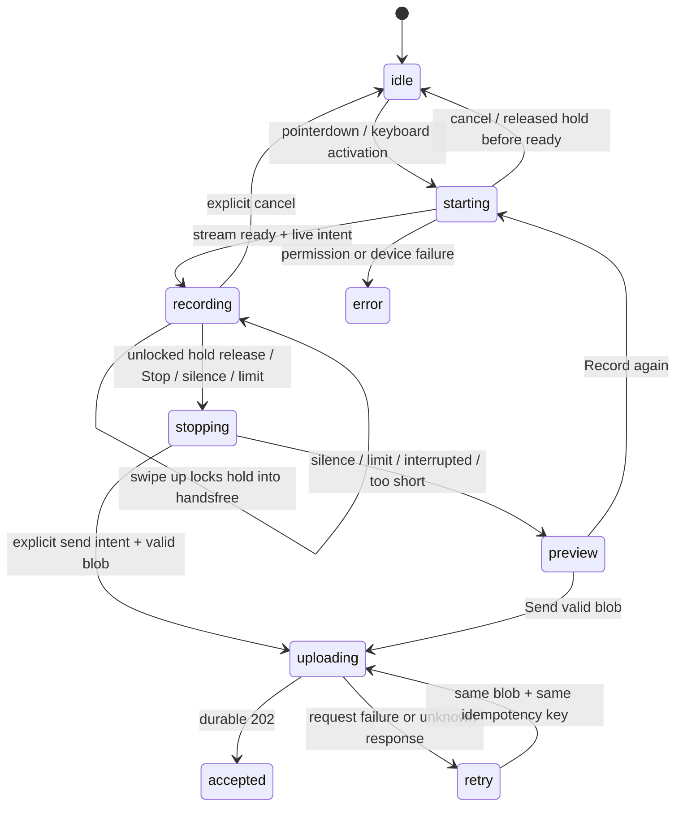

# Голосовой виджет: Telegram Android как ориентир и проект поведения

**Статус: для просмотра владельцем, не команда на реализацию или деплой.**
Дата аудита: 2026-11-03. Проверенная база Guide: `66392ee0cb96dc7d8c35e4bb516ce5d1515a1b3a`.
Основной и единственный UX-ориентир — Telegram Android. Порог тап/удержание
по уточнению владельца — 150 мс; удержание со смахиванием вверх закрепляет запись.
Числа из Android ниже отделены от наших настроек и целей измерения.
Это аудит исходников, а не измерение задержек на телефонах.

## 1. Как это будет выглядеть для человека

Одна основная кнопка микрофона, понятная подпись:

> Нажмите и говорите без удержания. Или держите кнопку и отпустите для отправки.
> Чтобы отпустить палец и продолжать запись, смахните кнопку вверх к замку.

| Действие | Предлагаемый результат |
| --- | --- |
| Нажал кнопку | Немедленный визуальный отклик и запуск получения микрофона; захват начинается сразу, как браузер его предоставит |
| Отпустил раньше 150 мс | Запись продолжается без удержания; видны секунды, «Стоп и отправить» и «Отменить» |
| Держал не менее 150 мс и отпустил, не закрепляя запись | Остановить и автоматически отправить полноценную запись |
| Удерживал и смахнул вверх до замка | Закрепить запись; отпускание больше не останавливает и не отправляет. Видны секунды, «Стоп и отправить» и «Отменить» |
| Нажал «Стоп и отправить» | Остановить и отправить, без обязательного отдельного предпрослушивания |
| После речи молчит 2,5 секунды | Автоматически остановить, сохранить запись для прослушивания и показать «Отправить» / «Записать заново» |
| Нажал «Отменить» / Escape | Остановить и удалить локальную запись, ничего не отправлять |
| Во время удержания увёл палец влево на 80 CSS px | Явная отмена с видимым индикатором; последующее отпускание не отправляет |
| Прервалось соединение при отправке | Запись остаётся в браузере для повтора с тем же ключом идемпотентности |

**Решение, которое нужно оценить владельцу:** после тишины предлагается только
остановка с предпрослушиванием, а после сознательного отпускания/кнопки стоп —
отправка. Пользователь просил автоотправку явно для удержания; поведение кнопки
стоп и тишины здесь обозначено как рекомендация. Человек может задуматься, а
детектор различает речь и паузу, не понимает смысл «я закончил отзыв».
Если нужна автоотправка также после тишины, это отдельная явно согласованная настройка.

Во время записи: индикатор микрофона, реакция на уровень звука, `00:07`, понятное
действие остановки/отмены. Секунды считаются от фактического начала записи, а не
от касания и не от открытия браузерного разрешения. Нет звукового сигнала,
попадающего в собственную запись. Анимация не блокирует обработку кнопки.

### Наглядные временные шкалы

```text
Удержание, микрофон уже разрешён:
0 мс         150 мс                     3 400 мс
│ нажал      │ режим удержания          │ отпустил
├─ запрос/старт записи ─────────────────┤ stop → blob → отправка
             ↑ не точка старта аудио, только граница жеста

Удержание со смахиванием вверх:
0 мс        150 мс         вверх ≥57 CSS px             отпускание
│ нажал     │ удержание    │ замок закрылся              │
├─ запись ────────────────→ запись закреплена ──────────→ продолжается
                          завершение только явным стопом / автостопом

Короткое нажатие:
0 мс     90 мс                                    6 000 мс
│ нажал  │ отпустил                               │ «Стоп и отправить»
├─ запрос/старт ───── запись без удержания ────────┤ stop → blob → отправка

Остановка по тишине (после подтверждённой речи):
последняя речь           +2 000 мс        +2 500 мс
│ тишина ────────────────│ предупреждение │ stop → прослушивание
                        «Пауза, останавливаем…»
Новая речь до порога сбрасывает паузу; сеть и ASR здесь не участвуют.
```

Невозможно заранее отличить короткий тап от удержания в момент `pointerdown`.
Поэтому порог 150 мс выбирает поведение **при отпускании**, а не задерживает запись.
Верхний предел скорости задают браузер, устройство, разрешение и запуск аудио;
обещание «звук с нулевой миллисекунды» было бы неверным.

## 2. Как сейчас устроен наш виджет

В репозитории два frontend-пути. Их код не изменился между PR11 и проверенным SHA.

| | Standalone Voice v1 | Старый Guide-виджет |
| --- | --- | --- |
| Файл | `src/involta_voice/static/widget.v1.js` | `src/involta_guide/web/static/widget.js` |
| Встраивание | `InvoltaVoice.mount`, Shadow DOM, несколько экземпляров, `unmount` | HTML `[data-voice-widget]` и JS Guide |
| Выбор на странице | `voice_enabled` и не Alex | флаг выключен либо Alex |
| Событие старта | `click` | `click` |
| Путь пользователя | клик → запись → стоп → preview → отправить | тот же |
| `MediaRecorder.start(timeslice)` | 250 мс | 1 000 мс |
| Обновление счётчика | каждые 500 мс | каждые 250 мс |
| Лимит UI | 120 секунд, 10 MiB | 120 секунд; отдельной проверки байтов в recorder нет |
| Удержание / тишина | отсутствуют | отсутствуют |
| Отправка | `/voice/api/v1/identity`, затем `/submissions` | `/api/reviews` |
| Потерянный ответ отправки | blob и ключ сохраняются; повтор идемпотентен | такого ключа в клиенте нет |

`timeslice=250` означает выдачу порций записанных данных, **не задержку старта**.
Интервал статуса после загрузки (2 секунды с backoff в v1) тоже не задерживает
микрофон и относится уже к обработке сервером.

Backend Voice проверяет фактический звук через ffprobe: номинально 1–120 секунд,
в коде верхний допуск до 121 секунды; размер до 10 MiB. Нельзя автоматически
отправлять запись 300 мс: сервер её отвергнет.

Существующий E2E `tests/e2e/test_voice_embed.py` проверяет два embed, отказ
разрешения, повторную запись, потерянный 202, тот же idempotency key, освобождение
ресурсов. Тестов жестов, тишины и гонок `pointerup`/разрешения пока нет.

Точки риска для реализации:

- `render()` полностью заменяет кнопки. Так нельзя делать с активной кнопкой,
  владеющей pointer capture: можно потерять отпускание и координаты жеста.
- Текущая state machine не знает `stopping`, отмену ожидания разрешения и
  автоматическую отправку. Добавить события в неё, не цепочку несвязанных boolean.
- Нужна защита от поздних callback предыдущей записи и нескольких `stop/send`.
- v1 освобождает ресурсы при явном `unmount`; отдельной обработки ухода со страницы
  во frontend сейчас нет. Legacy имеет `pagehide`. Новый lifecycle должен быть явным.
- Уже полученный текст отзыва и статус после отправки остаются главным результатом;
  изменение кнопки не переделывает ASR, анализ, модерацию или историю пользователя.

Живую страницу во время аудита прочитать не удалось: GET
`https://involta.ru/guide/ivanovo` вернул `HTTP Error 502: Bad Gateway` дважды.
Деплой в этот момент шёл. Поэтому активный production-флаг по HTML не подтверждён;
причина 502 здесь не установлена, сервер в рамках аудита не менялся.

## 3. Что именно найдено в Telegram

Ориентир — Android по закреплённому commit SHA. Web-клиенты не используются
для выбора жестов, порогов или задержек. Ранее просмотренные web-реализации
исключены из этого ТЗ, чтобы не смешивать разные UX.

| Параметр | Telegram Android | Решение Involta |
| --- | --- | --- |
| Активация | `ACTION_DOWN`, runnable после 150 мс, если доступен режим видео; без него сразу | Запрос микрофона сразу, порог жеста 150 мс |
| Короткое нажатие | До runnable переключает голос/видео при доступности обоих режимов | По требованию владельца — запись без удержания; видео у нас нет |
| Отпускание удержания | stop/send, если запись не закреплена и не отменена | То же |
| Закрепление | Движение вверх на 57 dp; `sendButtonVisible` делает отпускание неотправляющим | Вверх на 57 CSS px, фиксация handsfree до завершения записи |
| Дополнительная задержка старта | Планирование recorder: 50 мс обычно, 500 мс при активном проигрывании другого сообщения (`paused`); legacy и V2 | Не воспроизводить нативное планирование искусственным JS timeout |
| Короткое аудио | Legacy-путь отправляет при `duration > 700` мс | Наш существующий backend требует минимум 1 секунду |
| Отмена сдвигом | Дистанция зависит от ширины; расчёт 35% с максимумом 140 dp, дополнительные пороги progress | Отдельный жест отмены, описан ниже; не путать с закреплением вверх |
| Конец фразы по тишине | В проверенных путях записи не найден | Наше дополнение, 2,5 секунды, см. раздел VAD |

150/50/500 мс — разные ветви и этапы, а не измеренная end-to-end задержка.
Число 700 мс относится к изученному **legacy** recorder Android: не переносить
его автоматически на новый V2. 57 CSS px — браузерная адаптация порога 57 dp,
а не обещание одинакового физического расстояния на каждом устройстве. Не
умножать его на devicePixelRatio; проверить ощущения на реальных телефонах.
Вывод об отсутствии автостопа относится к просмотренным путям голосовых сообщений,
не звонкам и не всему Telegram.

### Проверяемые ссылки на исходники

Android, SHA `3de37c8cfb039452be7398909461da6288babf15`:

- [Нажатие, 150 мс, отпускание и отправка](https://github.com/DrKLO/Telegram/blob/3de37c8cfb039452be7398909461da6288babf15/TMessagesProj/src/main/java/org/telegram/ui/Components/ChatActivityEnterView.java#L2993-L3166).
- [Проверка разрешения и старт аудио](https://github.com/DrKLO/Telegram/blob/3de37c8cfb039452be7398909461da6288babf15/TMessagesProj/src/main/java/org/telegram/ui/Components/ChatActivityEnterView.java#L893-L958).
- [Блокировка вверх, 57 dp](https://github.com/DrKLO/Telegram/blob/3de37c8cfb039452be7398909461da6288babf15/TMessagesProj/src/main/java/org/telegram/ui/Components/ChatActivityEnterView.java#L2136-L2156).
- [Сдвиг для отмены](https://github.com/DrKLO/Telegram/blob/3de37c8cfb039452be7398909461da6288babf15/TMessagesProj/src/main/java/org/telegram/ui/Components/ChatActivityEnterView.java#L3170-L3219).
- [V2: 50/500 мс](https://github.com/DrKLO/Telegram/blob/3de37c8cfb039452be7398909461da6288babf15/TMessagesProj/src/main/java/org/telegram/messenger/MediaController.java#L4528-L4559), [legacy: то же планирование](https://github.com/DrKLO/Telegram/blob/3de37c8cfb039452be7398909461da6288babf15/TMessagesProj/src/main/java/org/telegram/messenger/MediaController.java#L5191-L5327).
- [Legacy: минимум >700 мс](https://github.com/DrKLO/Telegram/blob/3de37c8cfb039452be7398909461da6288babf15/TMessagesProj/src/main/java/org/telegram/messenger/MediaController.java#L5445-L5469).

Берём принципы жестов, быстрого отклика и явного состояния. Не копируем код
Telegram в проект; при заимствовании реализации отдельно проверяется лицензия.

## 4. Предлагаемые параметры Involta для первой проверки

Это стартовые настройки продукта, а не «значения Telegram» и не результаты тестов.
Собрать их в один конфиг виджета с документированными единицами и диапазонами.

| Параметр | Предложение | Обоснование |
| --- | --- | --- |
| Искусственная задержка запуска | 0 мс | `getUserMedia` вызывается из pointerdown; ни анимация, ни VAD не блокируют старт |
| Граница тап/удержание | 150 мс | значение Android, выбрано владельцем; дополнительной задержки 200 мс нет |
| Закрепление вверх | 57 CSS px от начала жеста | адаптация Android 57 dp; отпускание после закрепления не отправляет |
| Минимальное аудио | 1 000 мс | текущий контракт backend; реальная длительность проверяется сервером |
| Максимум | 120 000 мс | существующее ограничение, отдельный deadline от старта recorder |
| Порции MediaRecorder | 250 мс | сохранить текущее значение, не путать с частотой анализа речи |
| Таймер в UI | пересчёт каждые 100 мс, вывод `mm:ss` | часы монотонные, DOM обновлять при смене текста; aria-live не зачитывает каждый тик |
| Подтверждение речи | 400 мс speech-positive кадров | начальное значение для защиты от щелчков, не обрезает исходное аудио |
| Предупреждение о паузе | 2 000 мс | последние 500 мс перед автостопом видны пользователю |
| Конец речи | 2 500 мс непрерывно подтверждённого отсутствия речи | терпимость к паузам; итог зависит от тестов кафе/улица/тихий голос |
| До первой обнаруженной речи | 8 000 мс | остановка с сохранением валидного blob и сообщением «Речь не обнаружена»; не автоотправлять и не считать VAD доказательством пустого аудио |
| Отмена сдвигом | 80 CSS px влево | наше значение, с индикатором; без заимствования сложной формулы Android |
| Визуальный отклик | цель ≤50 мс на контрольном устройстве | измеряемая UX-цель, не задержка таймера |
| Вызов recorder.stop после команды | цель ≤50 мс в активной вкладке | не ждать анимацию, минимальную длину или сеть |

Если отпустили удержание, а фактическая запись короче 1 секунды: сразу остановить,
не доснимать после отпускания, не дополнять тишиной и не посылать заведомо
невалидный файл. Сохранить для локального прослушивания и предложить записать
длиннее. «Отправить» для заведомо слишком короткого файла недоступно.
Не выдавать длительность `performance.now()` за точный ffprobe: учесть границы
кодека, проверить реальный WebM/MP4/Ogg и показать ошибку сервера без потери blob.

На пределе 120 секунд остановить в preview, а не отправлять неожиданно.
При превышении размера — прекратить захват и явно показать ошибку; не отправлять
усечённые/повреждённые контейнеры. Верхний допуск backend не использовать как
разрешение продолжать запись до 121 секунды.

## 5. Определение конца речи в браузере

VAD — детектор наличия речи, не расшифровка и не понимание законченности мысли.
Амплитуда/RMS годится для анимации, но в кафе шум посуды и музыка делают её
ненадёжным единственным основанием для автостопа.

Предпочтительный кандидат: локальный Silero VAD через `@ricky0123/vad-web`
(vanilla JS API, без React). ONNX/WASM/worklet/model отдавать с нашего origin
под `BASE_PATH`, с закреплёнными версиями/хешами, без runtime CDN и отправки аудио
третьей стороне. Проверить лицензии и фактический размер загрузки до внедрения.
Не утверждать, что VAD бесплатно по CPU/трафику: эти расходы надо измерить.

Аудированная версия библиотеки: `2e5aca93e3902f04ff5b7eb4a9633926cdca9cf6`.
[Frame options](https://github.com/ricky0123/vad/blob/2e5aca93e3902f04ff5b7eb4a9633926cdca9cf6/packages/web/src/frame-processor.ts#L8-L47):
defaults `positive=0.3`, `negative=0.25`, `redemptionMs=1400`, `minSpeechMs=400`,
`preSpeechPadMs=800`. Это defaults **библиотеки, не Telegram и не принятые наши настройки**.
[Real-time API](https://github.com/ricky0123/vad/blob/2e5aca93e3902f04ff5b7eb4a9633926cdca9cf6/packages/web/src/real-time-vad.ts)
позволяет передать существующий stream и AudioContext; v5/v6 используют кадры
512 samples при 16 kHz, то есть 32 мс.

Для первой проверки взять v5 и пороги 0.3/0.25, затем измерить ошибки на русских
отзывах; это вероятности классификатора, не децибелы. Правило непрерывной тишины
реализовать явно по timestamp кадров: `p >= positive` — речь/сброс паузы,
`p < negative` — тишина, промежуточное значение — неопределённость, которая не
даёт дойти до автостопа. Не суммировать разрозненные паузы.

Не прибавлять 2,5 секунды к уже задержанному `onSpeechEnd`: получится двойная
задержка. Библиотечный frame processor может иметь собственную семантику
redemption; для нашего правила читать `onFrameProcessed` и иметь один счётчик
тишины. Порог предупреждения входит в 2,5 секунды, не прибавляется сверху.

- MediaRecorder пишет **полный исходный звук с момента готовности микрофона**.
  VAD только принимает решение об остановке, не режет/не склеивает фразы.
- Один stream на активную запись; VAD не делает второй `getUserMedia` и не
  выключает tracks самостоятельно раньше recorder. Не выводить микрофон в динамик.
- Модель можно предзагружать при приближении виджета к viewport или наведении,
  но не запрашивать микрофон до действия пользователя и не держать его в фоне.
- Если VAD грузится поздно, запись уже идёт. Отсчёт тишины допустим только после
  готовности VAD и подтверждённой им речи. Не трактовать пропущенные кадры как тишину.
- Если VAD не загрузился, отстаёт от live-потока или AudioContext suspended —
  отключить автостоп, оставить ручной стоп и показать короткий понятный статус.
- Речь другого человека/телевизор тоже может быть речью для VAD. Не обещать
  выделение владельца микрофона; это проверяется сценариями и доступностью ручного стопа.

## 6. Автомат состояний и гонки событий



`recording` содержит режим `undecided | hold | handsfree` и `pointerId`;
у handsfree фиксировать причину `tap | swipe_lock | keyboard`. Закрепление —
переход `hold → handsfree`, без stop/start recorder и без нового аудиофайла;
`stopping` хранит причину. `permission_pending` может быть подстадией starting.
Ошибки/отмена из остальных состояний определяются явно, диаграмма показывает
основной путь, а не полный перечень переходов.

Требования:

1. Pointer Events, primary pointer и левая кнопка мыши. Кнопка сохраняет DOM-узел
   и pointer capture до завершения жеста. Смена надписи не пересоздаёт его.
   `touch-action` локально на кнопке, не блокировать прокрутку всей страницы.
2. Не запускать вторую запись из `click`, который браузер генерирует после
   обработанного `pointerup`. Поддержать keyboard/assistive activation отдельно:
   Enter/Space запускают handsfree, autorepeat игнорируется, Escape отменяет.
3. Во время starting короткий отпуск (`<150 мс`) сохраняет явно заданное намерение
   handsfree: показать «Подключаем микрофон…» и кнопку отмены. Разрешение браузера
   может задержать старт на неопределённое время; таймер пока не идёт.
4. Если незакреплённое удержание отпущено до готовности stream — отменить намерение, поздний
   stream закрыть. После отмены, pointercancel, навигации или unmount микрофон
   не должен внезапно начать запись, когда разрешение наконец получено.
5. `pointercancel`/неожиданная потеря capture не означают «отправить». Остановить
   в preview, если есть полезная запись; до готовности — отменить. Обычную потерю
   capture вслед за обработанным pointerup не обрабатывать второй раз.
6. Счётчик длительности — `performance.now()` от recorder start. Deadline 120 с
   не зависит от обновления DOM-таймера; на скрытие страницы остановить в preview,
   без автоотправки. При pagehide/unmount освободить ресурсы; после ухода blob в
   памяти не обещать восстановить. Фоновое хранилище аудио в эту задачу не входит.
7. Обработать `track.ended`, mute/interruption, системный звонок и AudioContext
   suspension: явное состояние прерывания, сохранение того, что удалось записать.
8. Финализация одна: final `dataavailable` → `stop` → blob → send. Одновременные
   отпускание, тишина и лимит не создают второй blob/upload. После автостопа
   подавить остаточный pointerup/click исходного жеста.
9. Session/generation token игнорирует поздние promises/события старой записи.
   Новый старт не получает старый stream и не перезаписывает новый blob.
10. Один активный recorder на страницу при нескольких embed. Второй экземпляр
    не начинает скрытую параллельную запись; текущий upload не блокирует другой
    экземпляр навсегда. Сохранять поддержку mount/unmount и изоляцию Shadow DOM.
11. На ошибке отправки сохранить blob, key и контекст локации. Повтор — с тем же
    ключом; новый ключ только у новой записи. До отправки сначала cookie identity,
    как сейчас. Успех показывать по durable 202, не по локальному началу fetch.

### Детали жеста вверх (обязательная часть первого PR)

- При удержании показать над кнопкой замок и направляющую; кнопка/индикатор
  следуют за пальцем без ожидания окончания анимации.
- После определения hold (≥150 мс) считать вертикальное смещение от исходного
  `pointerdown`: вверх `dy <= -57 CSS px`. До порога показывать прогресс. При
  пересечении закрыть замок, переключить режим и подпись «Запись закреплена».
- Для диагонального движения выбирать ведущую ось: закрепление только при
  преобладании движения вверх; отмена — при преобладании движения влево и её
  собственном пороге. Равенство осей не выбирает действие; первое распознанное
  действие фиксируется. Отмена приоритетна только если она уже была распознана.
- Отпускание и последующий click после закрепления не отправляют, не останавливают
  и не запускают новую запись. Не допускать click-through в появившийся «Стоп».
- Закрепление необратимо в пределах этого жеста: возврат пальца вниз не возвращает
  hold. Для завершения — явная кнопка, отмена или описанный автостоп.
- Если pointer capture штатно освобождается после закрепления/отпускания, это не
  прерывание записи. Неожиданный cancel до завершения жеста всё ещё не отправляет.
- Если stream ещё не готов, уже распознанный swipe-lock сохраняет handsfree-intent,
  как короткий тап; показываются ожидание/отмена. Отменённое намерение никогда
  не восстанавливается после позднего разрешения микрофона.
- Первоначальный короткий тап всё так же запускает handsfree. Это требование
  владельца дополнительно к Android-подобному hold/swipe-lock, а не повод убирать
  жест вверх как якобы дублирующий.

## 7. Область будущей реализации

Основной компонент — standalone `src/involta_voice/static/widget.v1.js`.
Сохранить API встраивания, same-origin gateway, visitor ownership, лимиты,
cookie/роль администратора на сервере, расшифровку как первичный результат.
Платформенный recorder/VAD/UI не должен импортировать runtime Guide.

В репозитории legacy продолжает обслуживать Alex/режим выключенного Voice.
В первом PR НЕ переподключать его к публичному Voice endpoint: это меняет
права/команды. Для него оставить прежнее поведение и явно отметить границу;
после приёмки v1 можно отдельным заданием выделить общий recorder с разными
transport adapters. Основную приёмку проводить на странице, реально использующей v1.

Не переделывать backend ASR GigaAM/Parakeet, анализ, отзывную модерацию, ЧПУ
админки, очереди, Docker/деплой. Минимальная раздача VAD assets и тестовый стенд
допустимы, изменение общего CSP/заголовков основного сайта без необходимости — нет.
Проверить WASM без требования cross-origin isolation/COOP для всей involta.ru.

## 8. Как владелец сможет проверить до production

Исполнитель сначала делает отдельный стенд реального виджета с mock transport.
Без OpenAI, без публикации отзывов и без изменения текущего сайта. Микрофон на
стенде реальный и запрашивается явно; «отправка» перехватывается mock adapter.
Не добавлять произвольный публичный upload URL в production API встраивания.

На стенде нужны:

- Кнопка/таймер/волна/стоп/отмена и локальное прослушивание результата.
- Порог жеста фиксирован 150 мс, закрепление 57 CSS px; значения видны.
  Для аудита тишины — варианты 1,5/2,5/3,5 с, по умолчанию 2,5 с.
- Подпись VAD: загружается / готов / отключён. Включение/выключение автостопа.
- Журнал событий с относительными миллисекундами: pointerdown/up/cancel,
  permission requested/resolved, recorder start, speech/silence, stop requested,
  recorder stop, blob ready, mock upload started/accepted, причина остановки.
- Отдельно измерять доступ к микрофону, загрузку VAD, реакцию UI, финализацию
  кодека и сеть. Не выдавать задержку сервера ASR за медленную кнопку.
- Показ длительности/байтов/MIME и возможности прослушать первые/последние слова.
  Отладочные метаданные локальные; никаких аудио/секретов в консоль/публичные логи.

### Сценарии и критерии

| Проверка | Что должно произойти |
| --- | --- |
| Нажал на 100 мс | одна запись продолжается handsfree; synthetic click не перезапускает/останавливает её |
| Удержал 150 мс ровно | трактуется как hold; если звук <1 с — понятный too-short без POST |
| Удержал 3 с без закрепления | отпускание останавливает и делает одну отправку |
| Удержал, смахнул вверх на 57 CSS px, отпустил | одна непрерывная запись handsfree, ноль upload до стопа; замок видимо закрыт |
| Смахнул вверх на 56 CSS px и отпустил после ≥150 мс | закрепления нет, обычный hold-release; если достаточно аудио — одна отправка |
| После закрепления вернул палец вниз и отпустил | закрепление сохраняется, нет отправки |
| Диагональ вверх-влево, два пальца, pointercancel | одно однозначное действие; не происходит одновременно отмена, закрепление и отправка |
| Отпустил до stream ready | короткий тап — ожидаемый handsfree; hold — отмена; оба случая проверены с задержанным getUserMedia |
| Отказ разрешения/позднее разрешение после отмены | понятная ошибка/idle; все поздние tracks закрыты |
| Фраза — пауза 1 с — фраза | одна запись, нет обрезания первой/последней фонемы |
| Фраза — тишина 2,5 с | warning на 2 с, stop в preview около 2,5 с; не ещё +redemption |
| Речь вернулась на 2,4 с | отмена предупреждения и непрерывная запись |
| Молчание с начала | отдельный no-speech сценарий на 8 с, без отправки и без ложного «фраза закончена» |
| Шум кафе, музыка, чужая речь, тихий голос | замер ложных срабатываний; ручной стоп всегда доступен, ошибок VAD не скрывать |
| Отмена влево/Escape/pointercancel | ни одного upload; правила сохранения/удаления соответствуют причине |
| Stop одновременно с silence и release | один переход stopping, один blob и не больше одного логического submission |
| Нет VAD/WASM/сети загрузки модели | запись/ручная отправка работают, автотишина отключена явно |
| Ошибка upload и потеря 202 | повтор того же blob/key, один серверный отзыв |
| Лимит 120 с, 10 MiB, фоновая вкладка, unmount | stop/cleanup без зависшего микрофона, неожиданной отправки и утечек |
| Два embed, клавиатура, screen reader | нет параллельного захвата и недоступных кнопок; таймер не спамит aria-live |

Автотесты: детерминированные часы и VAD fixtures для переходов/границ; браузерные
тесты с настоящим MediaRecorder для финальных чанков и валидного контейнера;
сохранить существующие idempotency/unmount проверки. Ручная матрица: Android
Chrome, iPhone Safari, desktop Chrome/Firefox/Safari с версиями и устройствами.
Playwright Chromium не заменяет проверку iPhone.

До приёмки собрать по 20 попыток tap/hold/swipe-lock на контрольных устройствах; отчитаться
о случаях неверной классификации жеста, потере первых слов, p50/p95 задержек
start/stop (разрешение отдельно). VAD проверить на фиксированном наборе разрешённых
русских записей: паузы, кафе, тихая речь; указать ложные остановки, пропуски,
размер cold/warm загрузки, CPU и отставание анализа. Не выдумывать «пройденные»
замеры: если устройство недоступно, это явно остаётся непроверенным.

## 9. Порядок работ после согласования поведения

1. Утвердить таблицу сценариев и стартовые пороги (особенно отправку после стопа/тишины).
2. Сделать стенд и показать владельцу измеримые события, не менять production.
3. Реализовать state machine/gestures/lifecycle, затем локальный VAD и fallback.
4. Выполнить тесты/замеры, подготовить PR со ссылкой на стенд и результатами.
5. Production-деплой — отдельным решением после просмотра. Текущий деплой
   эта спецификация не меняет и не запускает повторно.
