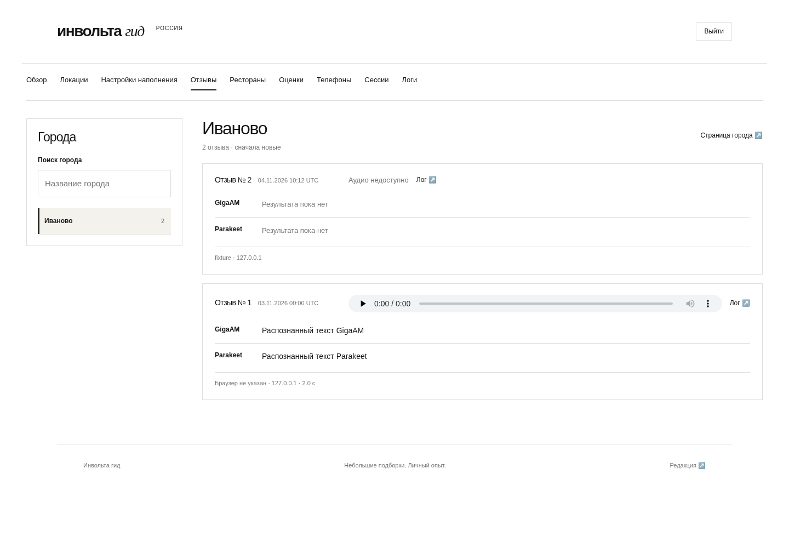
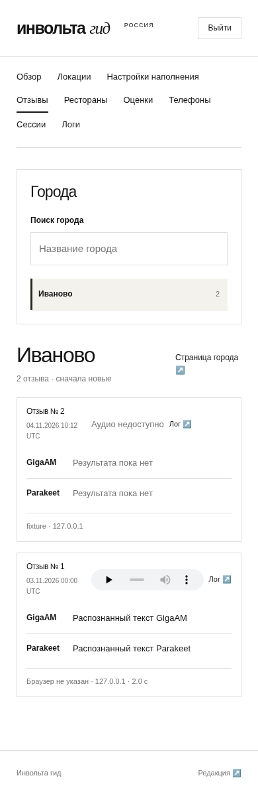

# Компактная лента отзывов

[Текущий контракт](../../ADMIN_REVIEWS.md).
[HTML-макет](prototype.html) — отдельный набросок с синтетическими данными.
Плеер перенесён в верхнюю строку по замечанию владельца.

Ниже screenshots **реального Jinja-интерфейса на тестовых данных**,
не production. Их создаёт браузерная матрица
`tests/integration/test_admin_design.py` (1440/768/390 px). Тестовые карточки
включают обычную запись с аудио и историческую без Voice-файла.

