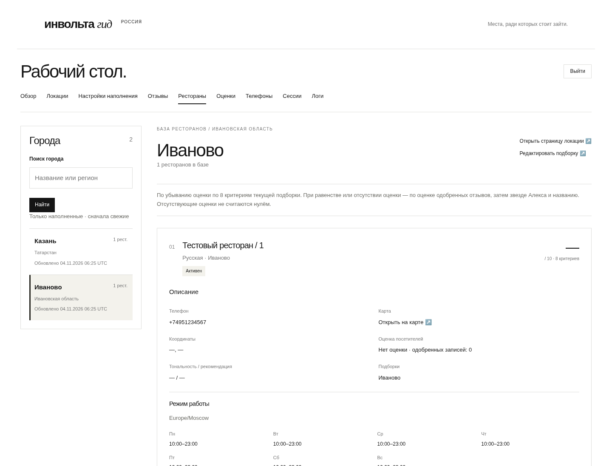

# Рестораны: город в пути и публичная ссылка

Снимки работающего локального приложения на тестовых данных. Это не production.
Сделаны Chromium-проверками `test_restaurant_browser.py` и `test_admin_design.py`.

Город: `/guide/admin/restaurants/ivanovo`. Справа над ресторанами — ссылка
«Открыть страницу локации ↗» на `/guide/ivanovo`, в новой вкладке. Следом —
существующая ссылка редактирования. Дизайн админки сохранён.

- [Desktop, 1440 px](desktop.png)
- [Mobile, 390 px](mobile.png)

Полный контракт и ручная проверка: [ADMIN_ROUTES.md](../../ADMIN_ROUTES.md).
