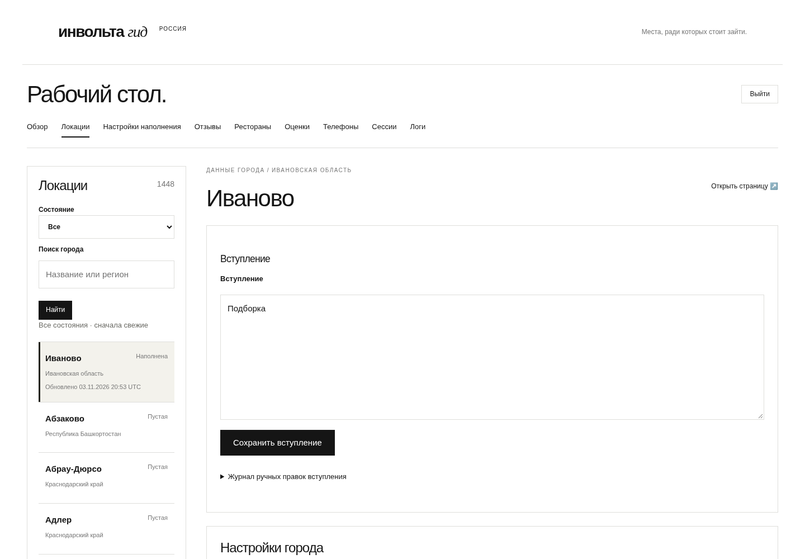
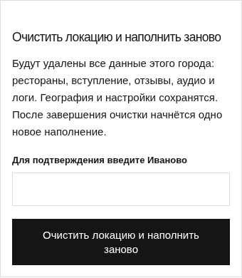
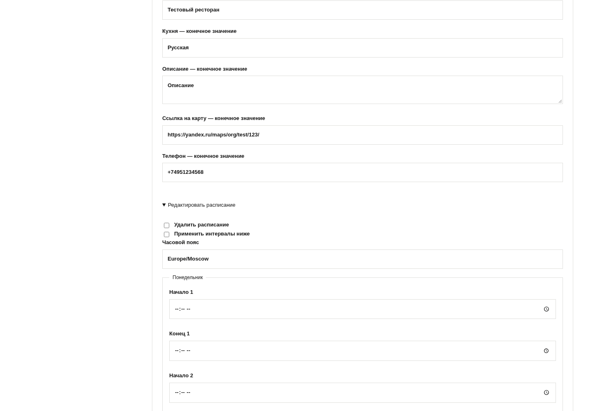
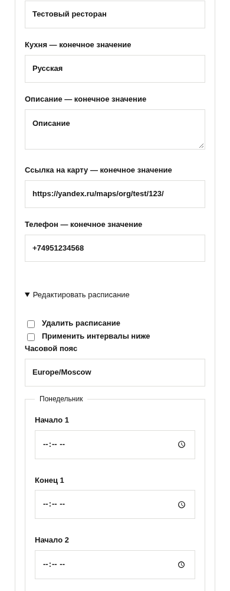

# Локальный браузерный рендер beta core

Это работающие шаблоны PR на синтетических данных тестов, не production.
Исходная компоновка админки PR17/18 сохранена. Архитектура и интерфейс реализованы
по поручению владельца на [BETA_CORE_SIMPLIFICATION_SPEC.md](../../BETA_CORE_SIMPLIFICATION_SPEC.md).

| Локация, desktop | Сброс, mobile |
| --- | --- |
|  |  |

| Единая карточка PR18, desktop | Mobile |
| --- | --- |
|  |  |

Матрица проверяется `tests/integration/test_admin_design.py`: desktop/tablet/mobile,
единый shell, навигация, обе ASR-модели, отсутствие горизонтального переполнения.
Полные скриншоты остальных экранов сохраняются в CI browser-screenshots artifact.
