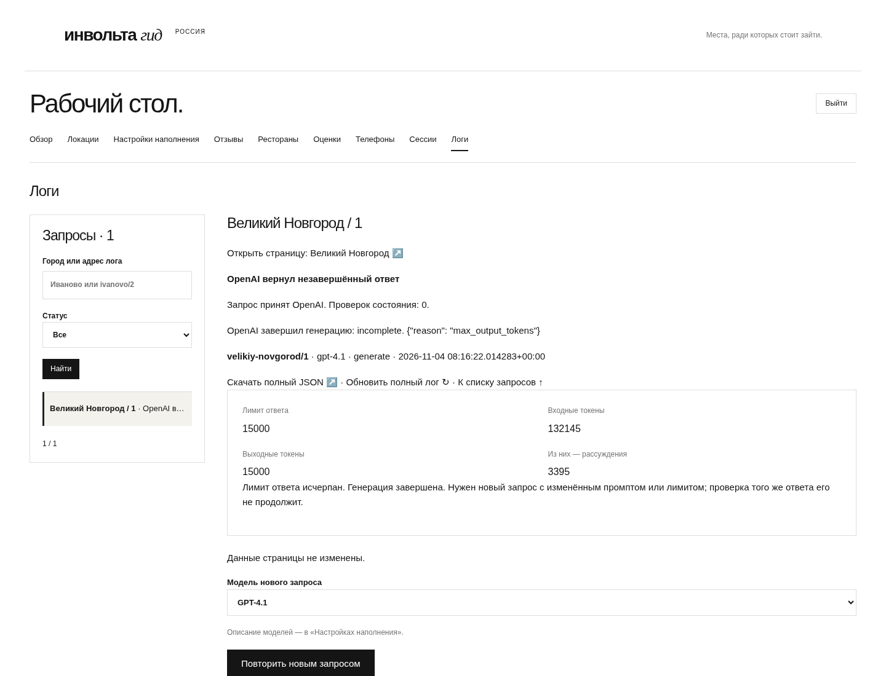

# Диагностика лимита ответа

Снимки работающего локального приложения с воспроизведённым ответом из лога
Великого Новгорода. Метаданные задания тестовые; это не production и не новая
генерация. Сохранены исходная причина обрыва и usage.

- [Desktop, 1440 px](desktop.png)
- [Сводка на mobile, 390 px](mobile.png)

Контракт и переход: [FILLING.md](../../FILLING.md).
